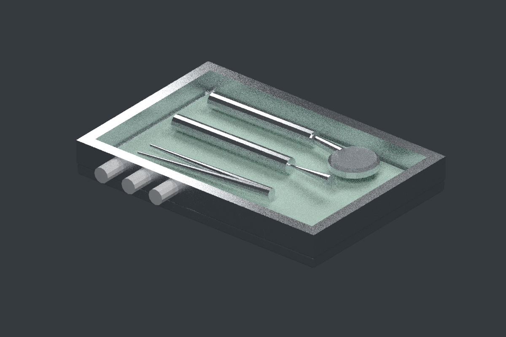
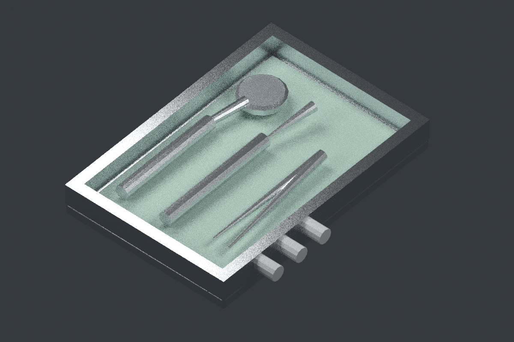
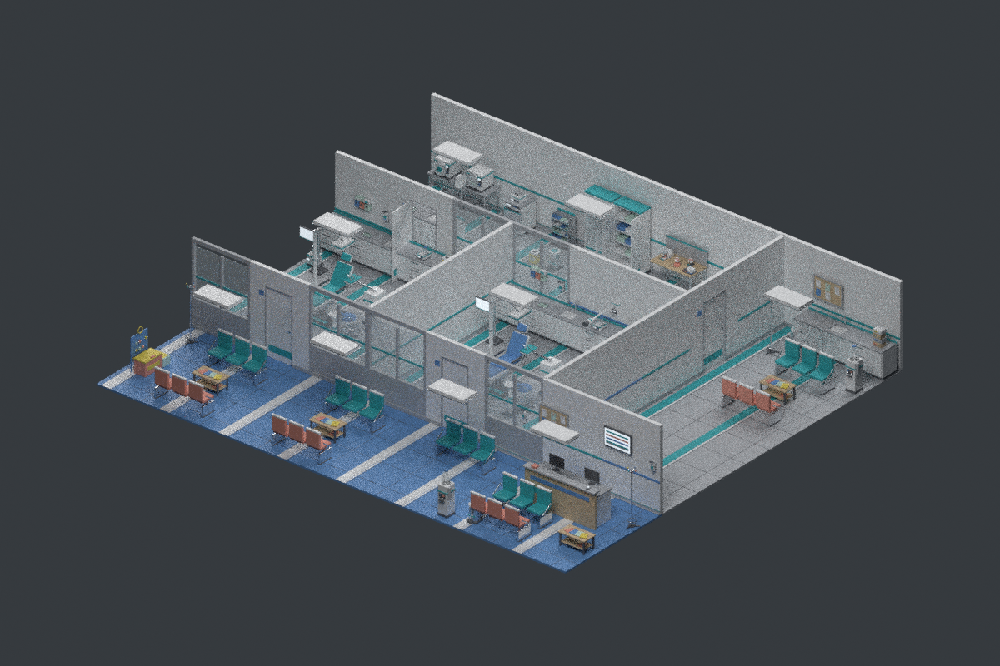
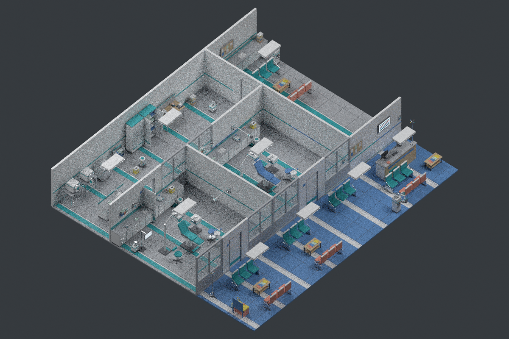

# Original native Blender previews — CC0 dental prop and clinic batch

Batch: `cc0-clinic-blender-20261101-v1`. Runner GitHub SHA: `e99cea92c7903894c4364d69577c0be4c1c87692`.
Source: https://3dassets.dev/packs/dental-practice-and-surgery; licensing: [CC0 1.0](https://creativecommons.org/publicdomain/zero/1.0/).
Creator: 3D Assets; contributor reported AI-assisted (Claude Opus 5). Model files were downloaded only from the pinned official CDN.
**No .glb model binaries were committed.** Real Blender-generated original PNGs only.
Visual acceptance: **pending independent direct pixel review**. Clinical acceptance: **NO**.
This is a clinic scene/prop candidate review, **not** migration of full KlinikLab or a calibrated dental simulation.

## Instrument Tray (Dental Practice and Surgery)

Source: https://3dassets.dev/assets/dental-practice-and-surgery-instrument-tray-33b4d81c; immutable binary version: v1 / 34383.
Original binary SHA-256: `63e3396b7ccd5c5227a8464473b25acb2cf79e5797ac7518b16f16c8f6228036`.
Native Blender: 4.0.2; meshes: 4; triangles: 728.
No FDI applicability, clinical mechanism accuracy, or visual review has been verified.

## Dental Practice and Surgery starter scene

Source: https://3dassets.dev/packs/dental-practice-and-surgery; immutable binary version: v1 / 34423.
Original binary SHA-256: `9af6dd52d96bf94d50eda63ee888db975fadabb230a5dcd2ff98a11a518db77a`.
Native Blender: 4.0.2; meshes: 1042; triangles: 121536.
No FDI applicability, clinical mechanism accuracy, or visual review has been verified.

