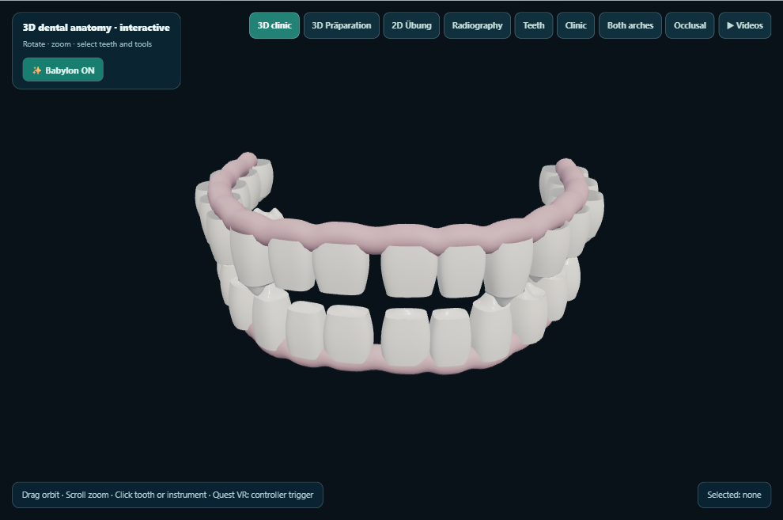
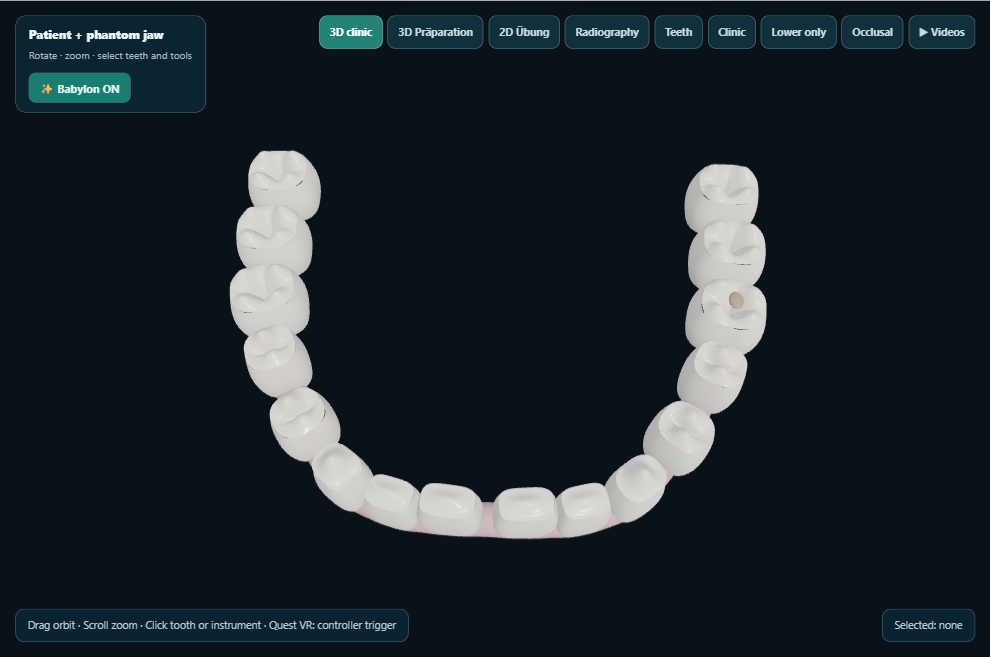
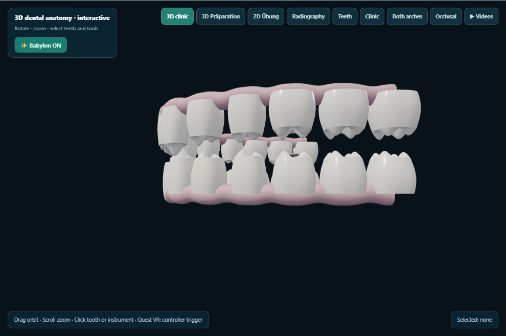
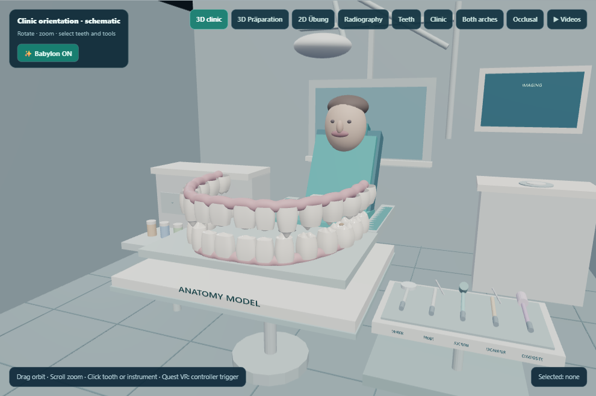

# KlinikLab visual QA — babylon-anatomy-v3-2026-10-29-01

Desktop captures generated on the owner’s PC. This does not test Quest 2.

Captured 5/5 views.

## 01-classic-teeth

## 02-anatomy-babylon

## 03-anatomy-occlusal

## 04-anatomy-oblique

## 05-babylon-clinic

