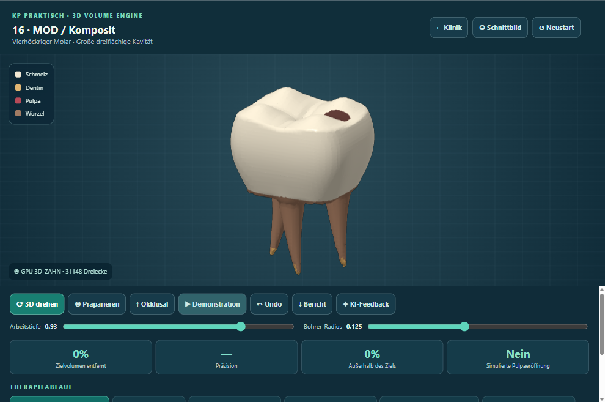

# KlinikLab visual QA — babylon-pbr-2026-10-29-01

Desktop captures generated on the owner’s PC. This does not test Quest 2.

Captured 3/7 views.

## 01-classic-teeth

## 02-babylon-teeth

Capture failed: Babylon preview unavailable: CPU geometry missing for xrvol-enamel

## 03-babylon-occlusal

Capture failed: Babylon preview unavailable: CPU geometry missing for xrvol-enamel

## 04-babylon-orbited

Capture failed: Babylon preview unavailable: CPU geometry missing for xrvol-enamel

## 05-classic-clinic

## 06-babylon-clinic

Capture failed: Babylon preview unavailable: CPU geometry missing for xrvol-enamel

## 07-preparation-unchanged

