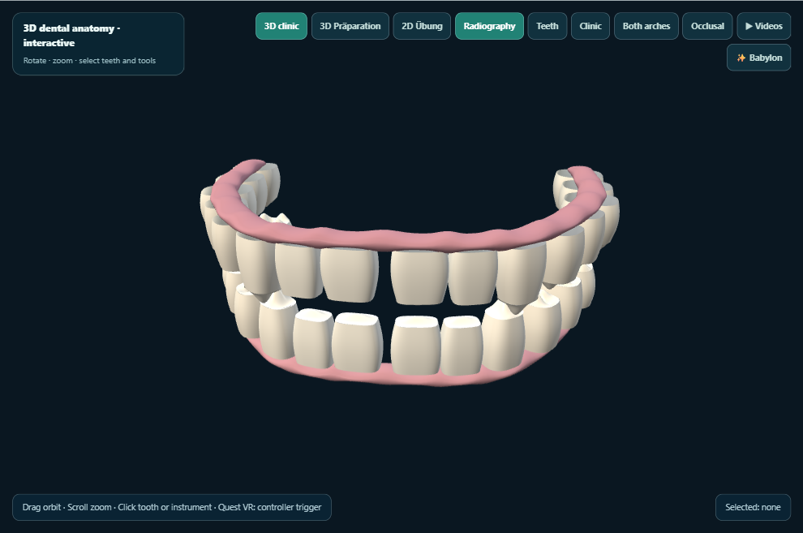
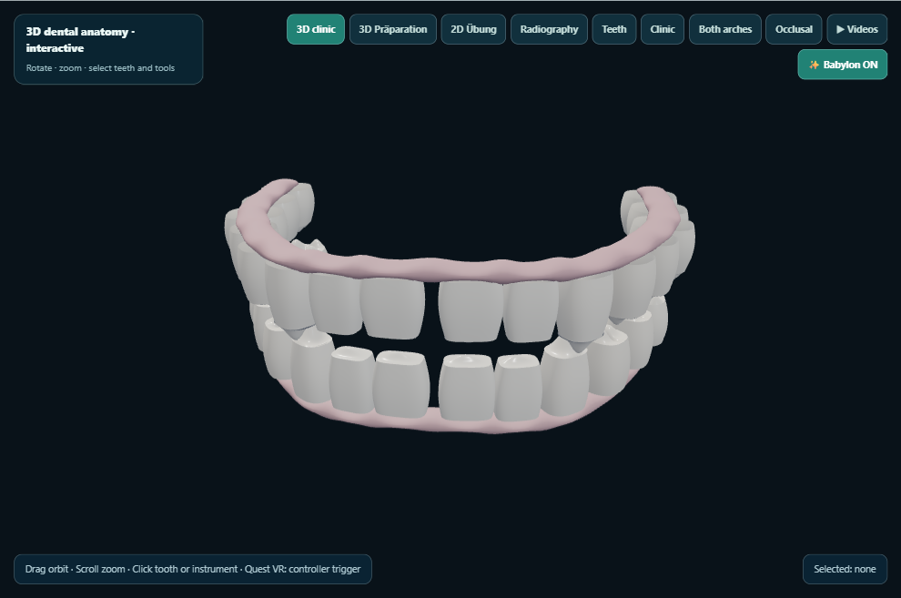
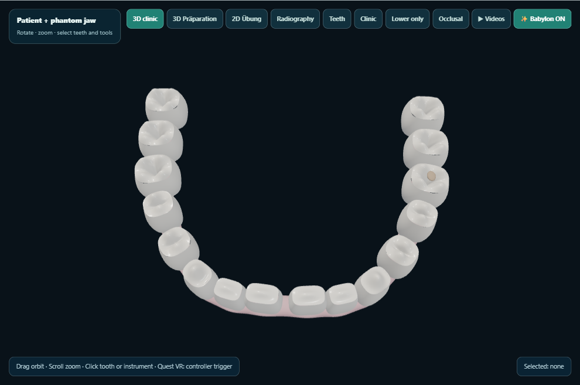
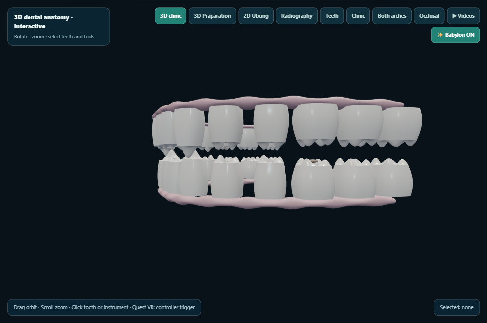
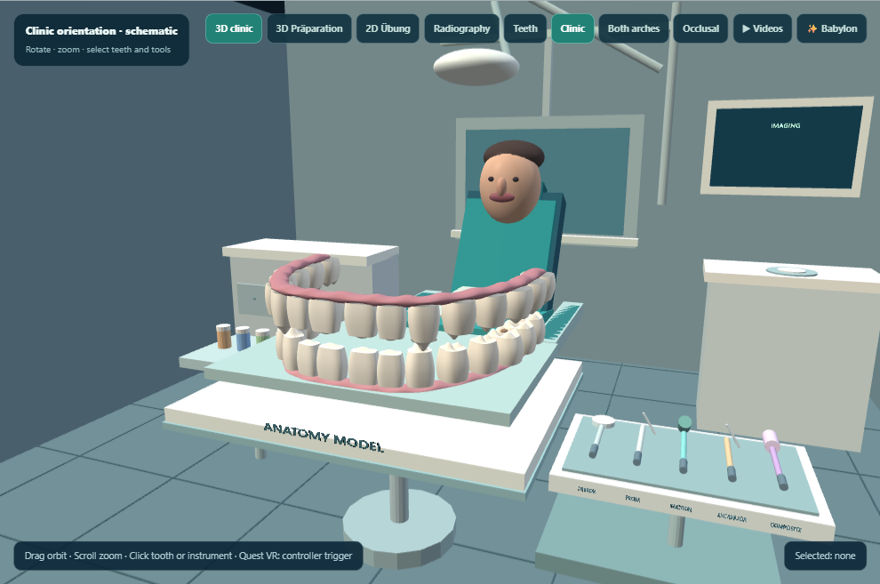
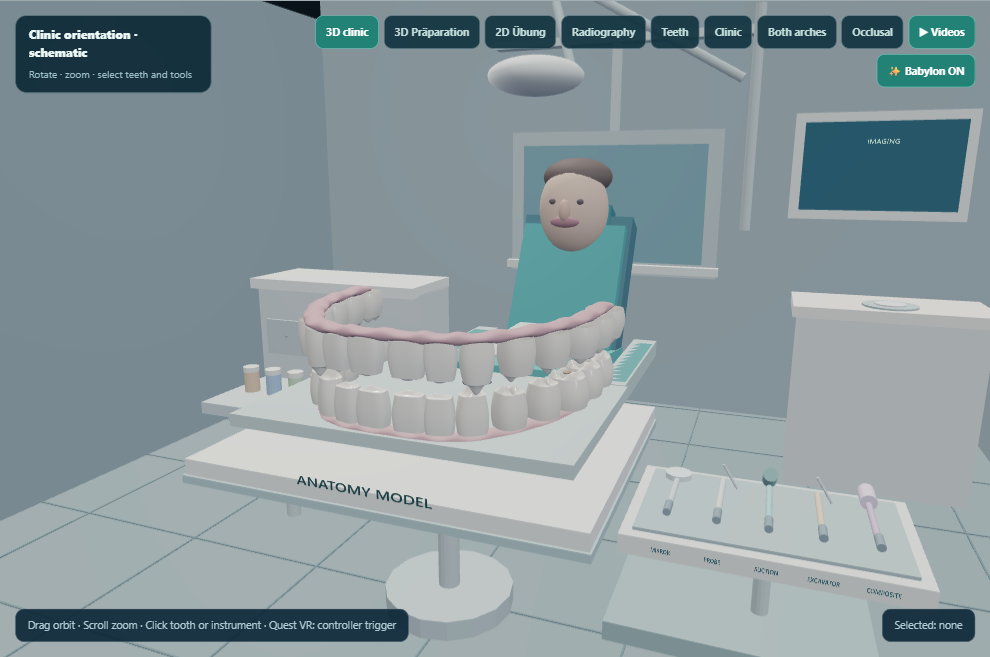

# KlinikLab visual QA — babylon-pbr-2026-10-29-02

Desktop captures generated on the owner’s PC. This does not test Quest 2.

Captured 7/7 views.

## 01-classic-teeth

## 02-babylon-teeth

## 03-babylon-occlusal

## 04-babylon-orbited

## 05-classic-clinic

## 06-babylon-clinic

## 07-preparation-unchanged

