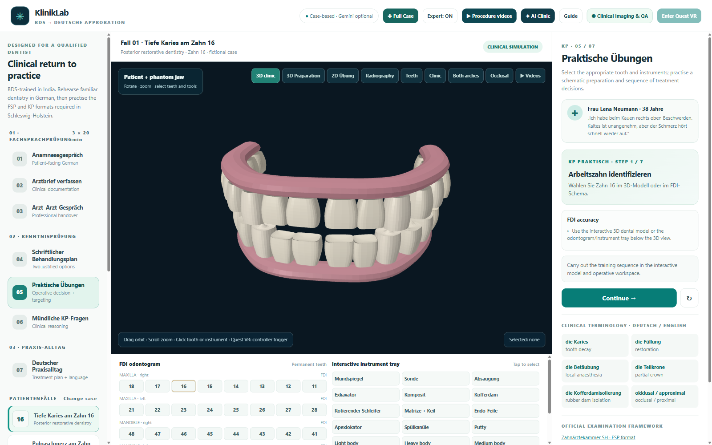
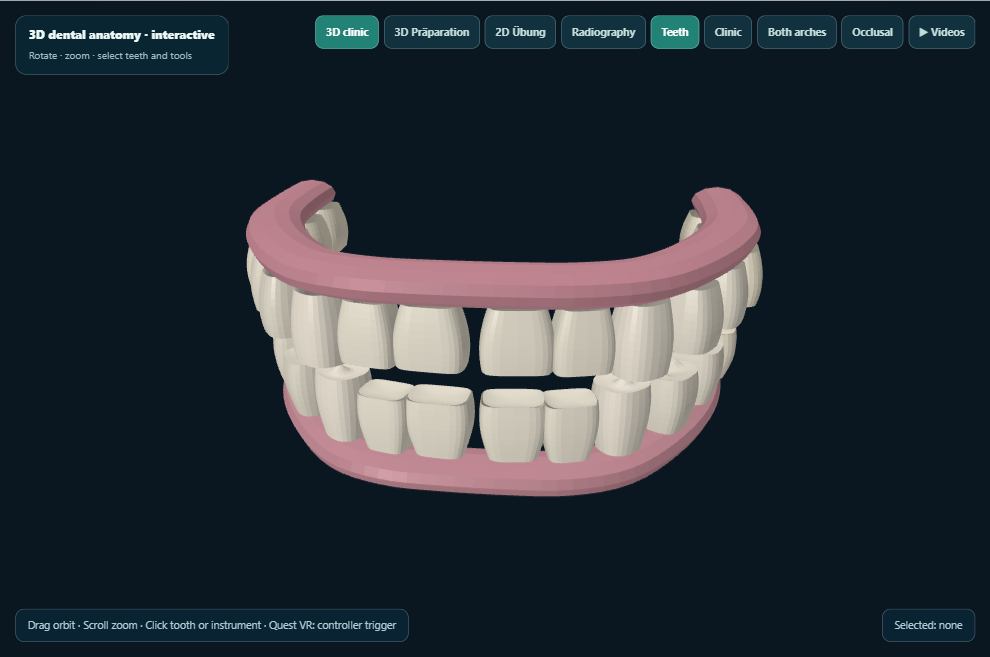
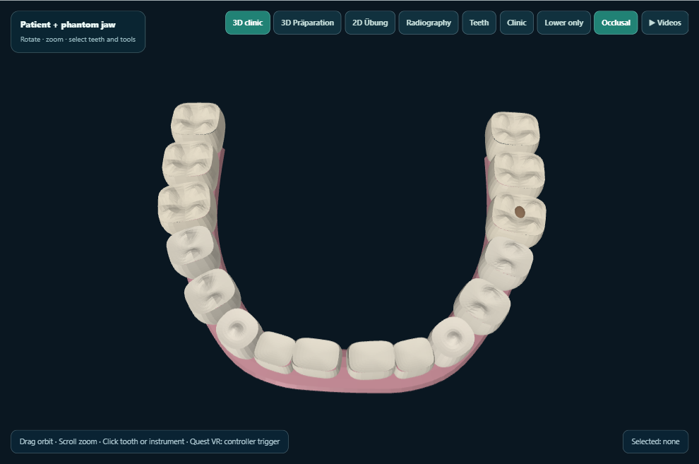
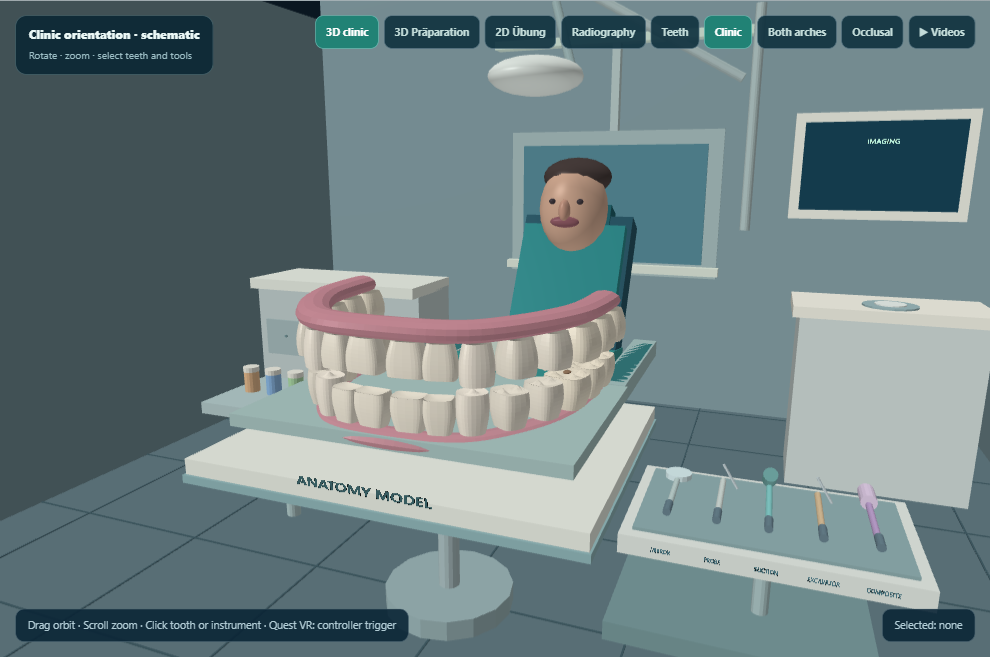
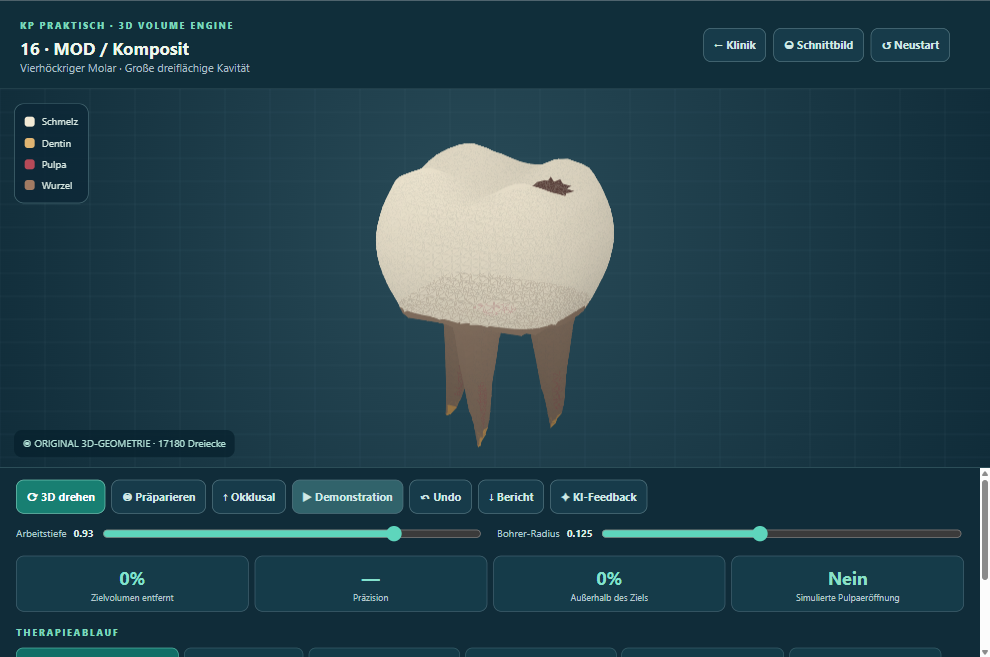
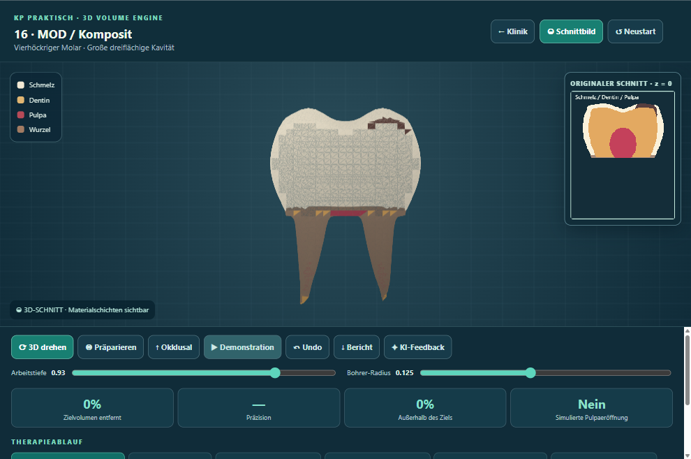
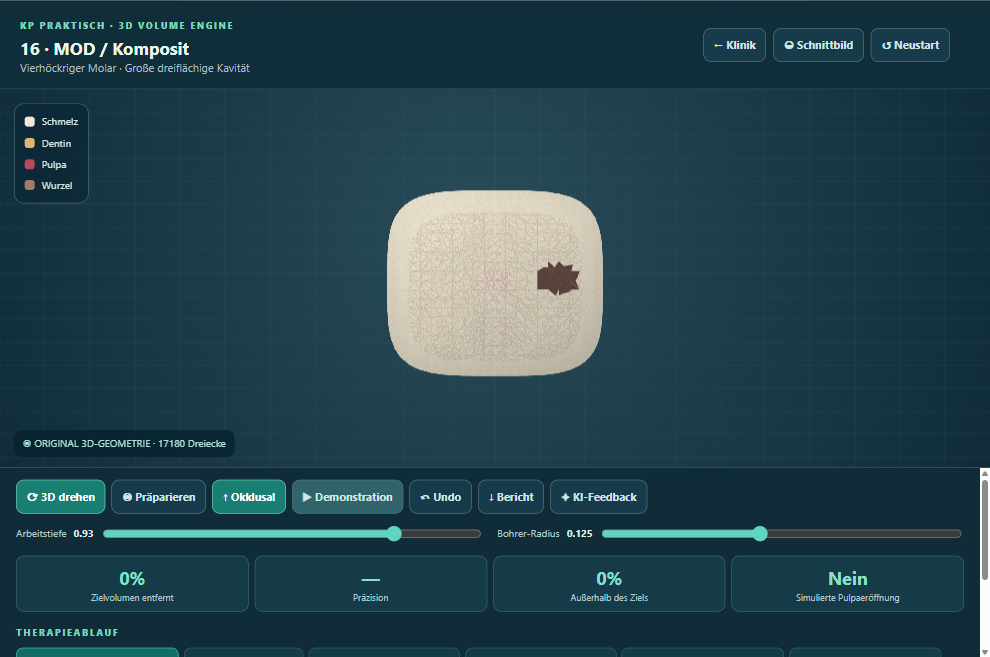
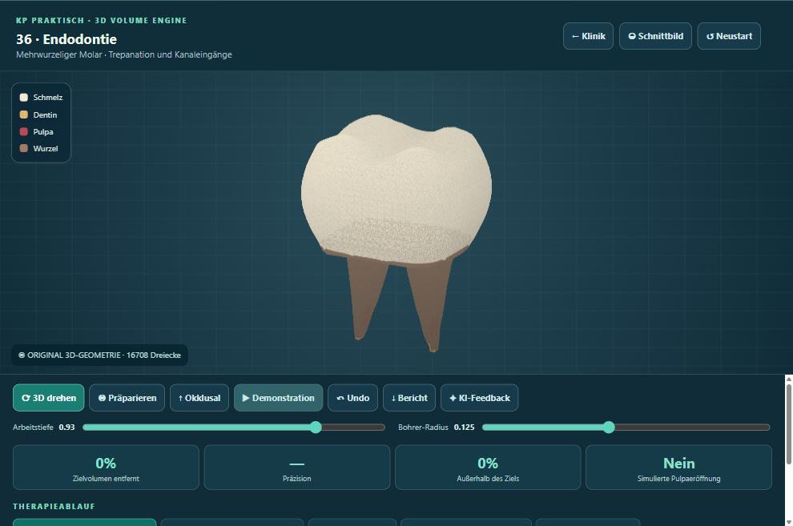
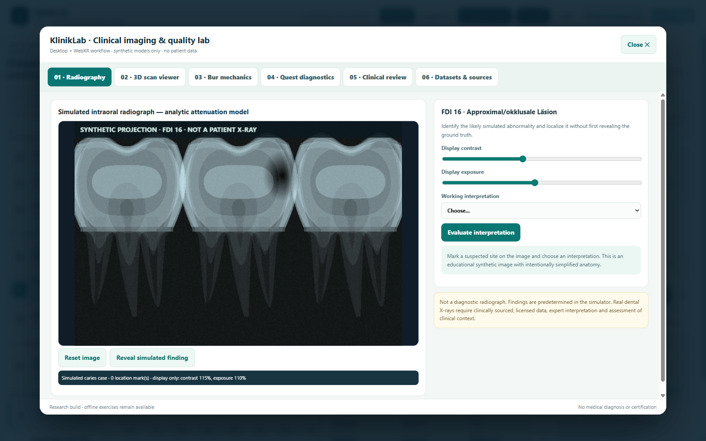
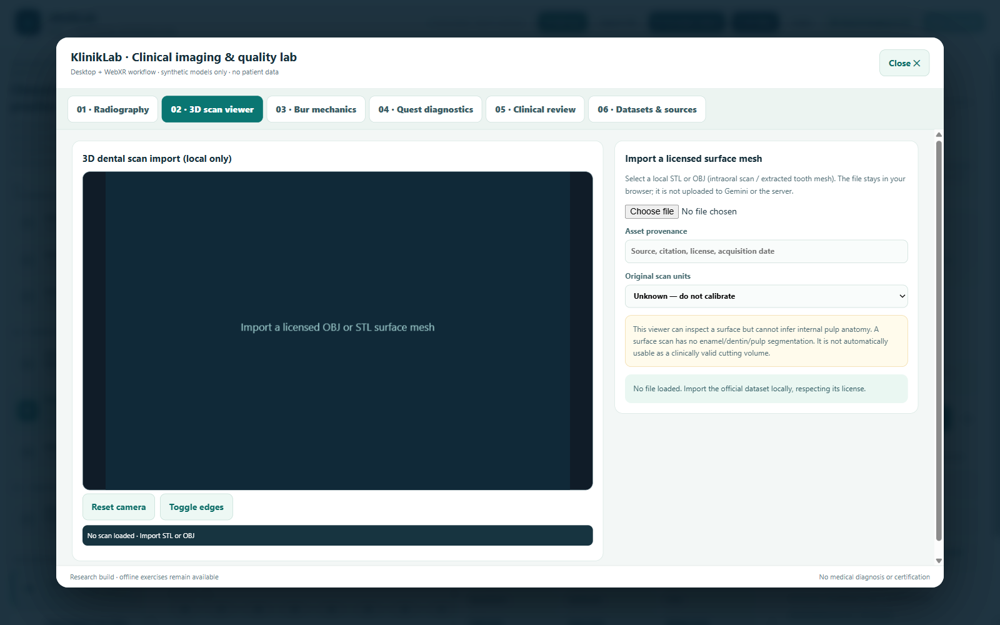

# KlinikLab visual QA — baseline-2026-10-29-01

Desktop captures generated on the owner’s PC. This does not test Quest 2.

Captured 10/11 views.

## 01-desktop-overview

## 02-3d-teeth

## 03-3d-occlusal

## 04-3d-orbited

Capture failed: The clinic canvas was not rendered

## 05-clinic-room

## 06-tooth-volume

## 07-tooth-cross-section

## 08-tooth-occlusal

## 09-endo-case-tooth

## 10-synthetic-radiography

## 11-scan-workstation

