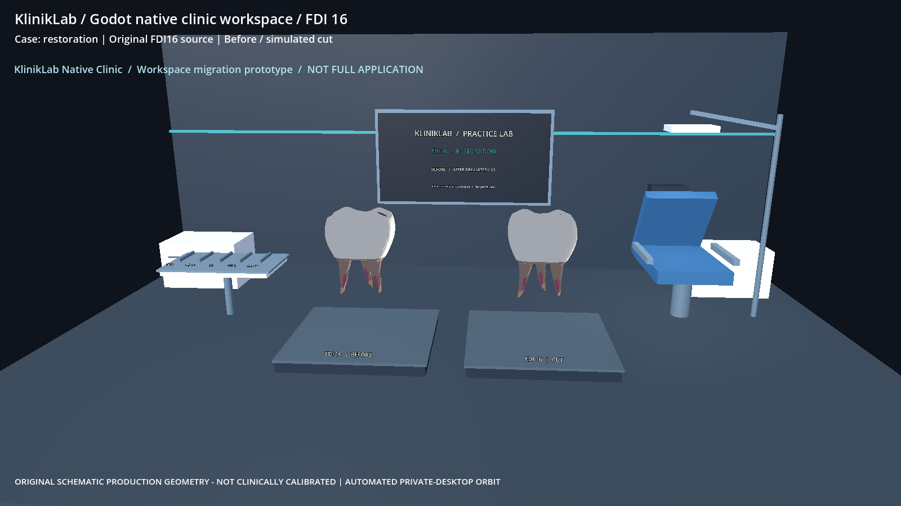
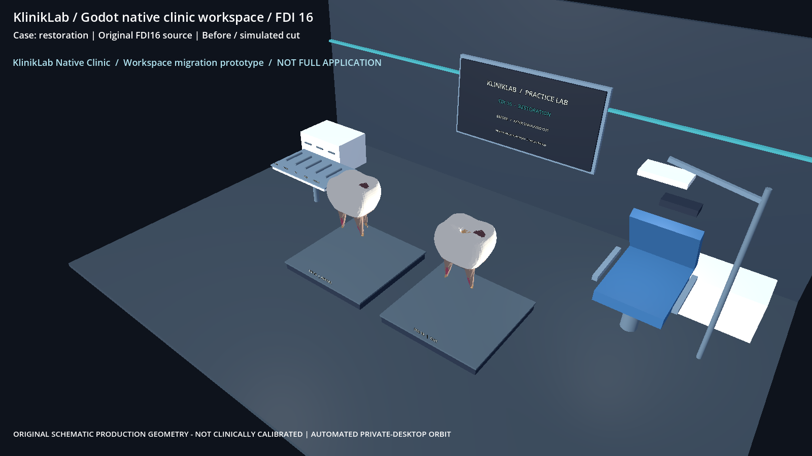

# SR1C real Windows owner-PC Godot evidence

Request ID: pc-godot-clinic-20261031-job06
Source pinned SHA: f4d4d4151851a08342def08d9f2e461f5f5e7109
Worker SHA: bb416139c3aa9c65e8506c237b0d25b623b59e6f
Native scene mode: clinic-overview
Full browser application migrated to Godot: NO (clinic workspace prototype only)
Status: NOT_ACCEPTED_PENDING_INDEPENDENT_PIXEL_AND_GPU_REVIEW

Evidence captured by dedicated Godot PC worker, **not** by GitHub Actions or Linux.
Source hash and screenshot pixel verification are independent tests.
No Quest/streaming success is claimed.

godot-job-result.json: SHA256 dc29465a18cfac894d69fc19f1c92aea1392adbf377d10b144984cd88f63b388

godot-owner-pc-result.json: SHA256 bcddedf0967a67a7e2e92fe09ce62f025298e1009fc698edd875f36b1d94d370

native-source-submission.json: SHA256 3462fa882426fdffa6b2175c544c6f1643cb6afff0a63aeddbf3cce37c436c52

godot-source-prepare.json: SHA256 3fd796c9e25cf50dc0c85a0717edb46b77c1869078a237d158d098fe0d857ce5

godot-gpu-3d-counters.json: SHA256 2de2c33a45344df8f61f27e6c460ab2add709afcb10c802cb4fe0844c40244e0

godot-gpu-pdh-diagnostics.json: SHA256 2ff83e6a2f1899e11864761711f90ea20133fe03b8dbdf1b49f9a2bd3a9dbd0e

godot-background-capture.json: SHA256 7c8c874b5f392b9d331e5eb6332e8fefb3e61b8bf22bf5fe9401c9cd4d72dea7

godot-native-background.log: SHA256 577a54750f374005a918a5d1b8a0244748ec9433d62b287f4b57e800beacd28e

godot-native-fdi16.png: SHA256 15ddf76a147242cb91496ab14467b6d794ed91eb00f0b8c1e6311d62c3a802bc

godot-native-fdi16-occlusal.png: SHA256 01fba7b6be7a3853f986ff2384b6c72cf958a19060c98acc3a4046f5c8d30495

If present, original native PNG requires independent pixel review:

