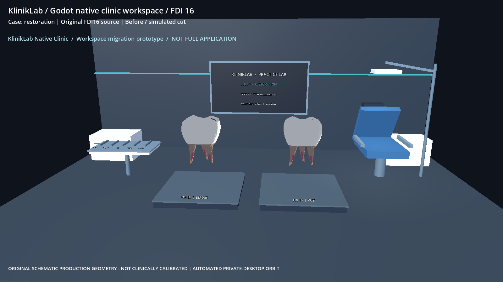
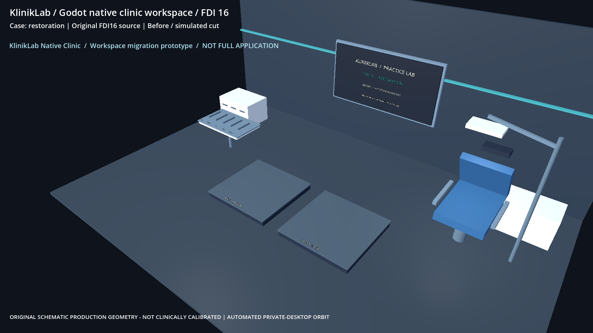

# SR1C real Windows owner-PC Godot evidence

Request ID: pc-godot-clinic-20261101-job07
Source pinned SHA: f4d4d4151851a08342def08d9f2e461f5f5e7109
Worker SHA: c3f2f71a1f6e2d48fc1a7144ea023b6e13863ebf
Native scene mode: clinic-cases
Full browser application migrated to Godot: NO (clinic workspace prototype only)
Status: EVIDENCE_INCOMPLETE

Evidence captured by dedicated Godot PC worker, **not** by GitHub Actions or Linux.
Source hash and screenshot pixel verification are independent tests.
PUBLICATION-ONLY RECOVERY: existing original image bytes. NO rerender, NO owner-PC result, NO attributable GPU acceptance.
No Quest/streaming success is claimed.

godot-job-result.json: SHA256 c9c0d4a062d66608b7c2f9dfe6b82377fa7148aa30593f551891350ad23c1d35

godot-job07-forensic-review.json: SHA256 a381c709940dd101780b30dfcd2ec53f287c0c3b1ad3389492f81119891da5fd

native-source-submission.json: SHA256 3462fa882426fdffa6b2175c544c6f1643cb6afff0a63aeddbf3cce37c436c52

godot-source-prepare.json: SHA256 f10e19bcd49c04ea9b0a13939a80cf2d5e3fc5a4fe76ccc0debf424aa6a42775

godot-native-cases-prepare.json: SHA256 aa2efc71d5ca0ec4adebd546a96ddfe1c8e12f8bc8a6a2c4222dae66e45c45ca

godot-native-workflow-state.json: SHA256 e0fb9479ec7124157ba7fd0258d35acafae291085bf460e720161bd74e1924f7

godot-background-capture.json: SHA256 9f37cfbed89e3b3676e95415f81bccc61b1ba2ef22ca92de65ef344d8f130627

godot-native-background.log: SHA256 7236840ef827213cdc71a288fc50085886502b34c5aad80bb745adffbd2aa234

godot-native-fdi16.png: SHA256 42fc74c2777f10d3b790c141f46cebbc3f950d2e222b7a43b79e1a03b1aad623

godot-native-fdi16-occlusal.png: SHA256 7ceccf400115c3506a7c73cb9dbf8a99d79efcd45bb24f80954760be9e6df32b

If present, original native PNG requires independent pixel review:

