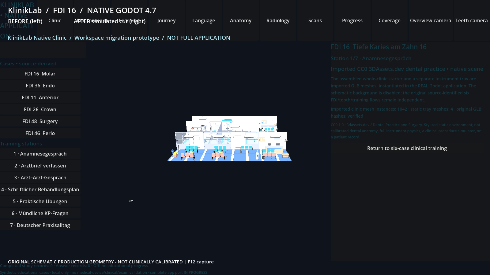

# SR1C real Windows owner-PC Godot evidence

Request ID: pc-godot-exported-20261101-cc0-job12-approved-678f92
Source pinned SHA: 678f92e28dd3a1e1bb98c4d94e58028eefa5d9ec
Worker SHA: 033fb0520212fe696df02bf2a0c5aca12ad3e848
Native scene mode: native-exported-cc0
Full browser application migrated to Godot: NO (actual EXPORTED CC0 partial application)
Status: NOT_ACCEPTED_PENDING_INDEPENDENT_PIXEL_REVIEW

Evidence captured by dedicated Godot PC worker, **not** by GitHub Actions or Linux.
Source hash and screenshot pixel verification are independent tests.
No Quest/streaming success is claimed.

godot-job-result.json: SHA256 f66d0dfdd37eb6f3c2f5e9a2bf70f61e9b00e77b15628ef0cc638c8b247df3c9

godot-owner-pc-result.json: SHA256 8326e6f7e7dd1e63a5d4df9d3e38d309f471a968064a8bd8b6524a4417302357

native-export-provenance.json: SHA256 aac521e74dc12b25483a0401303244e1cd77d95f4c0a8da254eab73b931dda25

native-exported-app-result.json: SHA256 95062fcb1a9c6e5f0658d226b507bca7792decc44cefed0d31bc3e57e282489b

native-exported-app.log: SHA256 3b045d15d498aac2814edfe21ee18bdcc2e8f1ffd903cde7c8ceec0037401dbd

godot-gpu-3d-counters.json: SHA256 a3e148806a490f4ab69b217b1e72941b489464d1dc9887b48a7de9710fdf70ba

godot-gpu-pdh-diagnostics.json: SHA256 46166079ad441de73f597336e671e8580a3d01f4535c0570f819e9e0946b8521

kliniklab-exported-cc0-environment.png: SHA256 727e59e4fefe2218a2049351bd102219eca0cc6e8dea9a4766fd98f14a794c27

kliniklab-exported-fdi36-practical.png: SHA256 ebc470d22e89389ecf62abb29a24b8a012876d5c978ce7c2bf1963e704812d9d

If present, original native PNG requires independent pixel review:

No original occlusal native PNG was returned.
