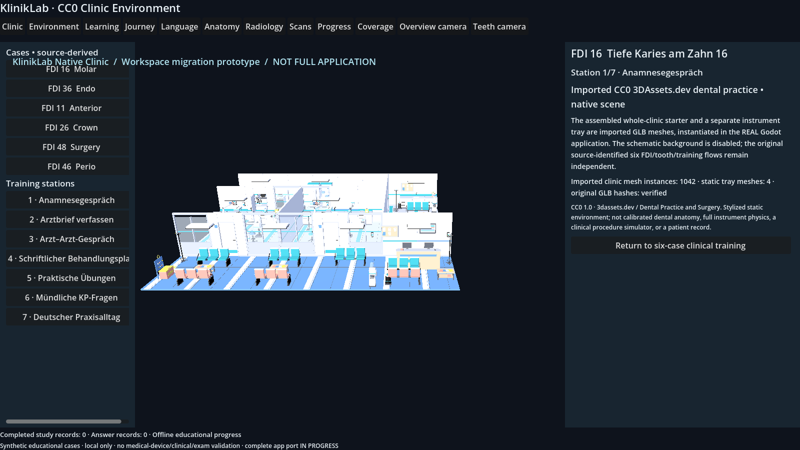

# SR1C real Windows owner-PC Godot evidence

Request ID: pc-godot-exported-20261101-cc0-job13-6a077f
Source pinned SHA: 6a077fc8781d9b51ea34a751986a0187cd163764
Worker SHA: 033fb0520212fe696df02bf2a0c5aca12ad3e848
Native scene mode: native-exported-cc0
Full browser application migrated to Godot: NO (actual EXPORTED CC0 partial application)
Status: NOT_ACCEPTED_PENDING_INDEPENDENT_PIXEL_REVIEW

Evidence captured by dedicated Godot PC worker, **not** by GitHub Actions or Linux.
Source hash and screenshot pixel verification are independent tests.
No Quest/streaming success is claimed.

godot-job-result.json: SHA256 bd57d3a6193dbf20fa512a414090c898253391606bbc1f100650f3086d8d6117

godot-owner-pc-result.json: SHA256 72352db930d7f28eacdcacc4c2dd240ab488d5f9f4197b7edece1e69157a9524

native-export-provenance.json: SHA256 3caa568cfb9bd7658188c3cb6aa74f985e7f3805b02354dfe1ad267fcd354a68

native-exported-app-result.json: SHA256 91678cfb5911bb3020cc02e630c24ec493d5c31619e8024da7edee6bd6b58b30

native-exported-app.log: SHA256 b5ac45900ff6f27e56adc6ed61515d13291d0ed0d801ceee44960ed447cfd16b

godot-gpu-3d-counters.json: SHA256 5be58ce98060745f4a1aadd4158057a0d06a32fdedef0b24ab678b7c4441996f

godot-gpu-pdh-diagnostics.json: SHA256 ae639218477638a8f3a98f983019666447e813b14e1ff9c02d92fbc5167246aa

kliniklab-exported-cc0-environment.png: SHA256 ca293976cd82d9d5d5c8896f613d26ecee52c604171ffd6ef94f5a5ccd1fc29b

kliniklab-exported-fdi36-practical.png: SHA256 992ae15501235f9c77e55e83061080b865cc3c9fb69d9b127f3cd85879b9e301

If present, original native PNG requires independent pixel review:

No original occlusal native PNG was returned.
