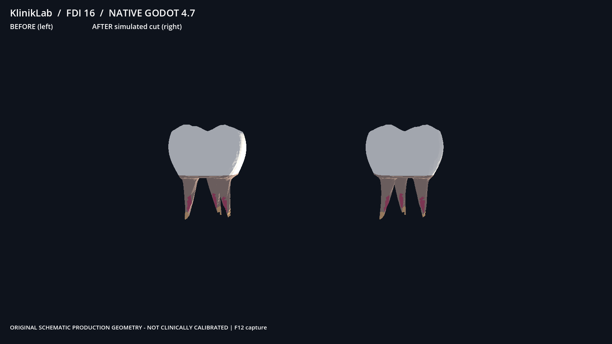

# SR1C real Windows owner-PC Godot evidence

Request ID: pc-godot-fdi16-20261031-job04
Source pinned SHA: f4d4d4151851a08342def08d9f2e461f5f5e7109
Status: EVIDENCE_INCOMPLETE

Evidence captured by dedicated Godot PC worker, **not** by GitHub Actions or Linux.
Source hash and screenshot pixel verification are independent tests.
No Quest/streaming success is claimed.

godot-job-result.json: SHA256 9e28ea28925ed61165de29e72e2dd1a2fd1ae8d95e8267cd8c9e66d7c741f6c1

godot-owner-pc-result.json: SHA256 cc3ca98a7a4509297784b572f32ea573f945219c51742fcb032c786ea855257c

native-source-submission.json: SHA256 3462fa882426fdffa6b2175c544c6f1643cb6afff0a63aeddbf3cce37c436c52

godot-source-prepare.json: SHA256 02ac6469bafb585e0ab35a559f7016050e98ae0f248138061329509d425b07f5

godot-gpu-3d-counters.json: SHA256 32666377f8471de2626f5c468970f373493fa035614bf77bb52dbf11a38e233b

godot-background-capture.json: SHA256 51bbe9deae6a9b6f6e6c6563df469e47b44b00c0f5804c0675caffc849e98966

godot-native-background.log: SHA256 2a796ec54c35323742be0dd4f8037d95e9c49b6a76e026614bbcb8315a111a68

godot-native-fdi16.png: SHA256 d8e92a28ab409f9f51ed279c8c6bcb3d53f25bfd663459ebccdbeddb700cc411

If present, original native PNG requires independent pixel review:

