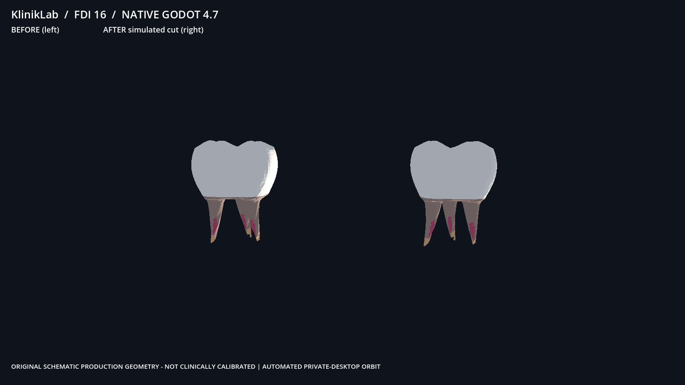
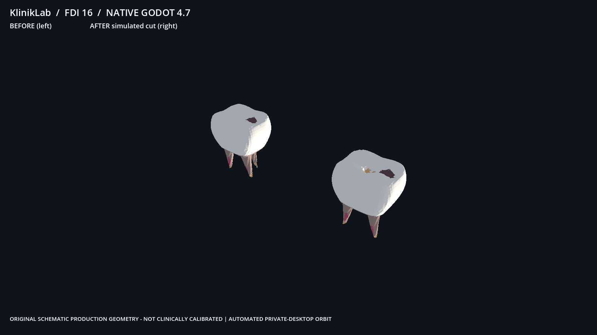

# SR1C real Windows owner-PC Godot evidence

Request ID: pc-godot-fdi16-20261031-job05
Source pinned SHA: f4d4d4151851a08342def08d9f2e461f5f5e7109
Status: EVIDENCE_INCOMPLETE

Evidence captured by dedicated Godot PC worker, **not** by GitHub Actions or Linux.
Source hash and screenshot pixel verification are independent tests.
No Quest/streaming success is claimed.

godot-job-result.json: SHA256 f0312d4472c79faffd9b54e16b381fc96028f53dc8c7475315fb031784794d15

godot-owner-pc-result.json: SHA256 c4aee8a4cf96b31bc6cc7ce8aec83fa4d7712a35d7abb1f44360d00991900456

native-source-submission.json: SHA256 3462fa882426fdffa6b2175c544c6f1643cb6afff0a63aeddbf3cce37c436c52

godot-source-prepare.json: SHA256 e17aadfa5aa24c7a803a901c80edc24fbde81964f3a6ce5b1b2c5583921ff476

godot-gpu-3d-counters.json: SHA256 285386bcbda5b2338822b19266a2b90c6d87e9da18401f9148c69e469c11bcb7

godot-background-capture.json: SHA256 1663460eee494383e034a0ab04bba7d0de3204751a5e493b7727e8b2bdd4d124

godot-native-background.log: SHA256 97a3b17bd1c20be574e4f1035e8557f04a3a730272be2dbbd6b0d1474fbeb971

godot-native-fdi16.png: SHA256 5e04724ea633c3d8a36504e418c1cd10df725eddba622519bc8b75af1799072f

godot-native-fdi16-occlusal.png: SHA256 52126d95739081a062ebf9afb1961cb1d4e0919e4dbceedd80f013e233f41806

If present, original native PNG requires independent pixel review:

