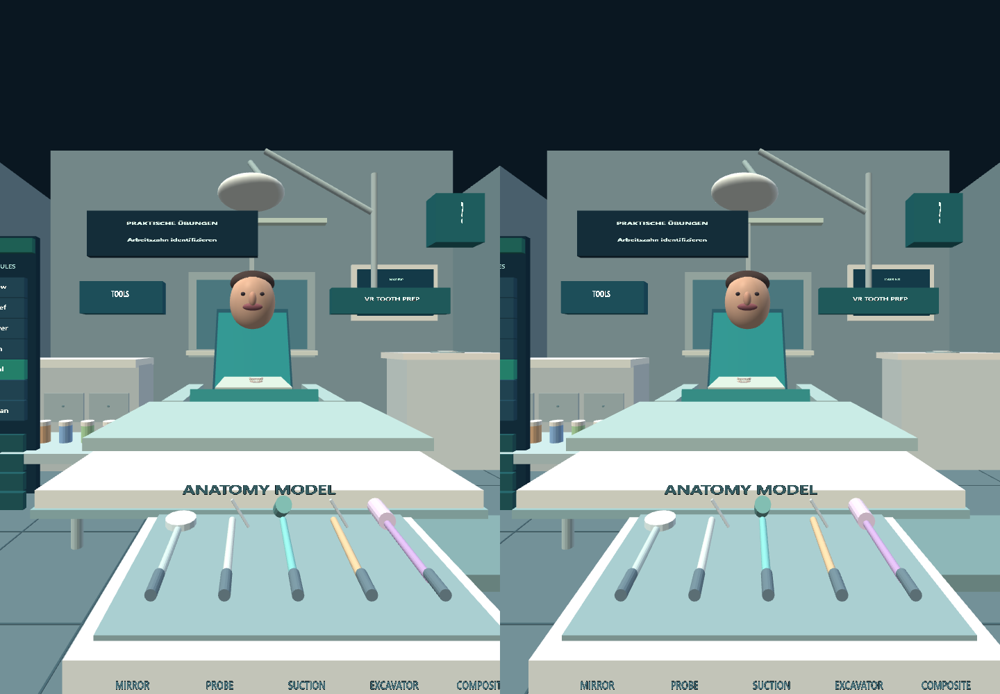
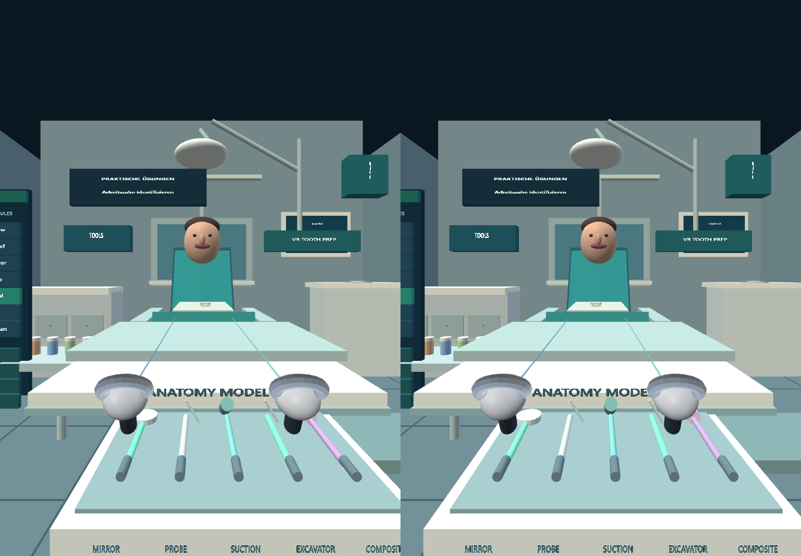
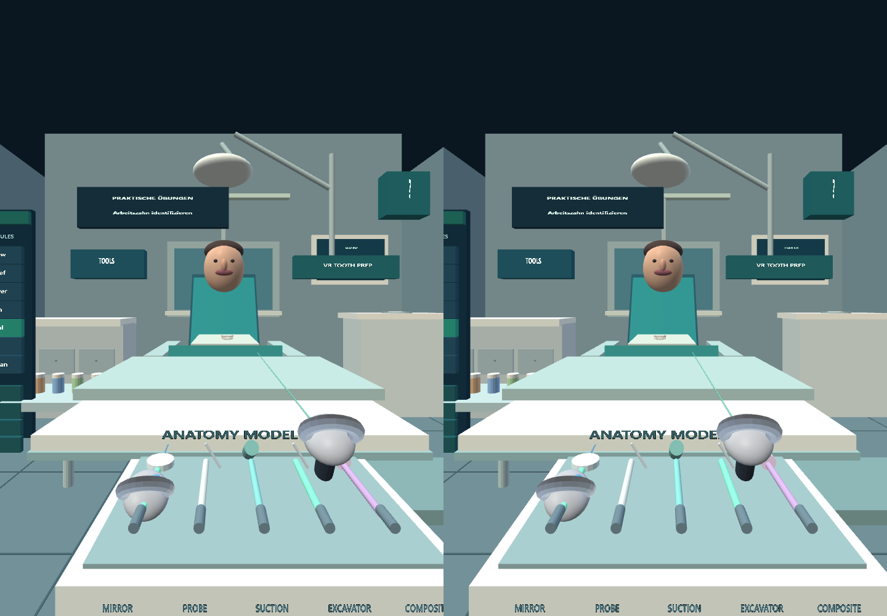
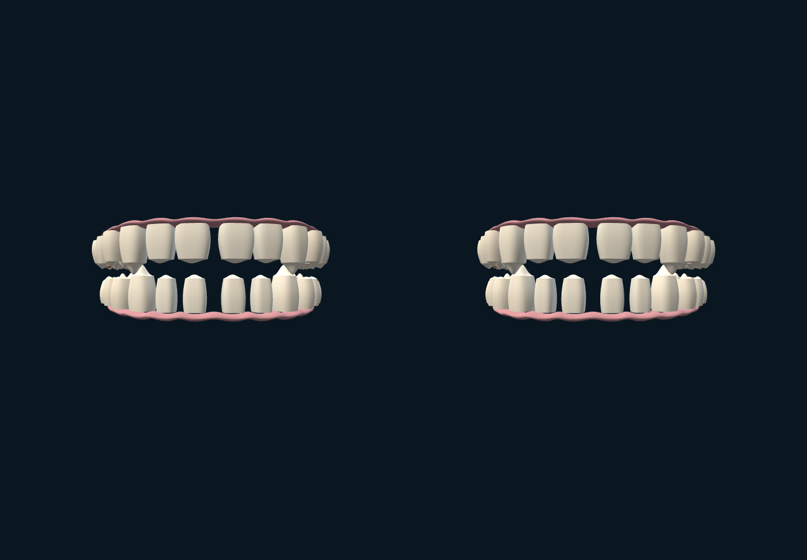
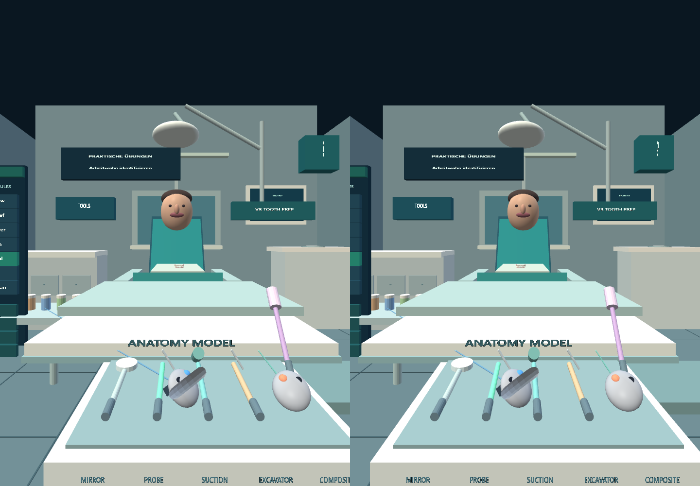
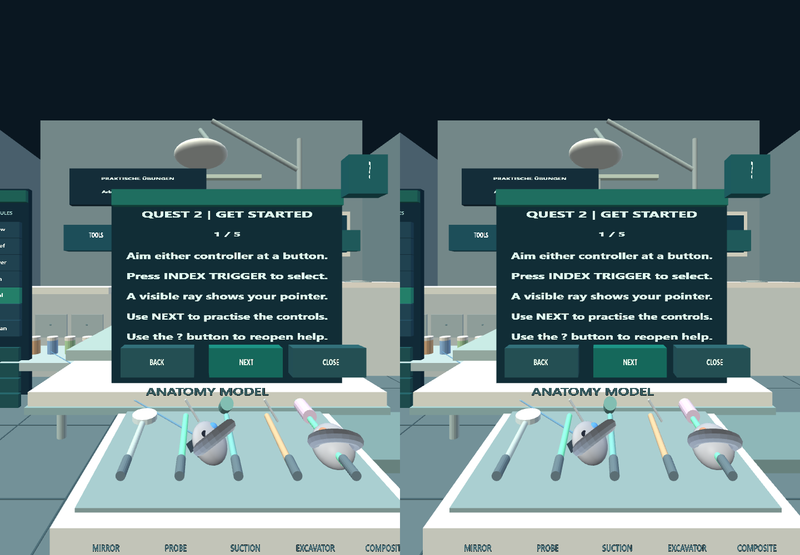
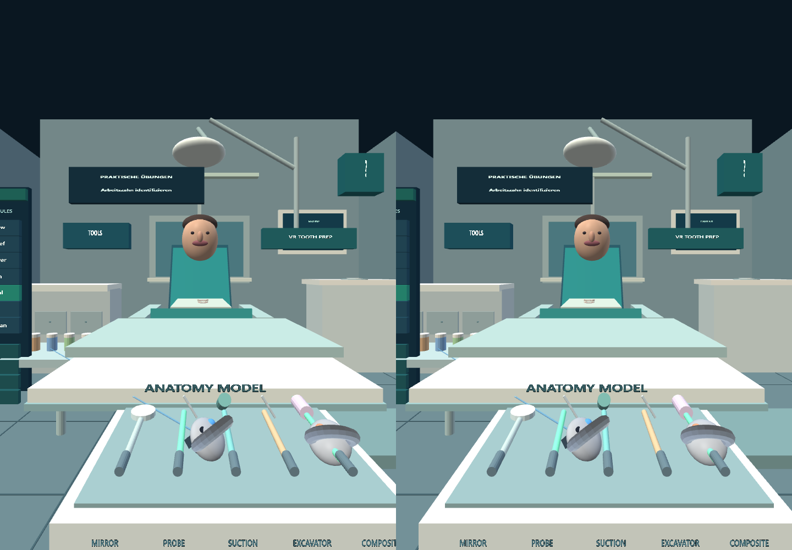
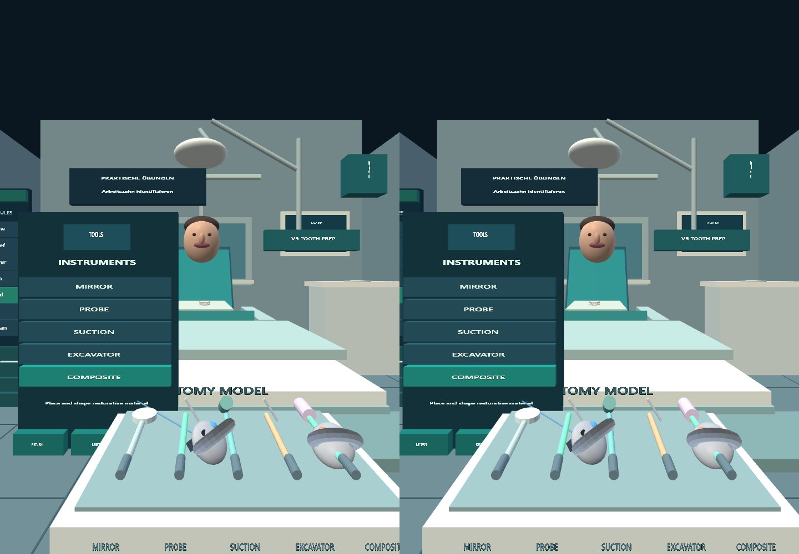

# Owner-PC XR evidence

Job: pc-xr-phase7-navigation-20261030-03
Tested commit: 0166e298c4764860e0505ac7e54adc843b97e0fd

Meta IWER Quest2 in desktop Chrome; not physical headset evidence.
Captured from a newly rendered XR eye frame when framebuffer readback is supported.
Duplicate frames: [{"file":"10-tool-catalog-closed.png","sameAs":"08-help-closed-after-close.png"}]

## 01-room-table-unobstructed.png

## 02-both-controller-models.png

## 03-left-tool-hover.png

## 04-left-hand-mirror-pickup.png

## 05-mirror-release-return.png

## 06-right-hand-composite-pickup.png

## 07-help-opened-by-question-mark.png

## 08-help-closed-after-close.png

## 09-tool-catalog-open.png

## 10-tool-catalog-closed.png

