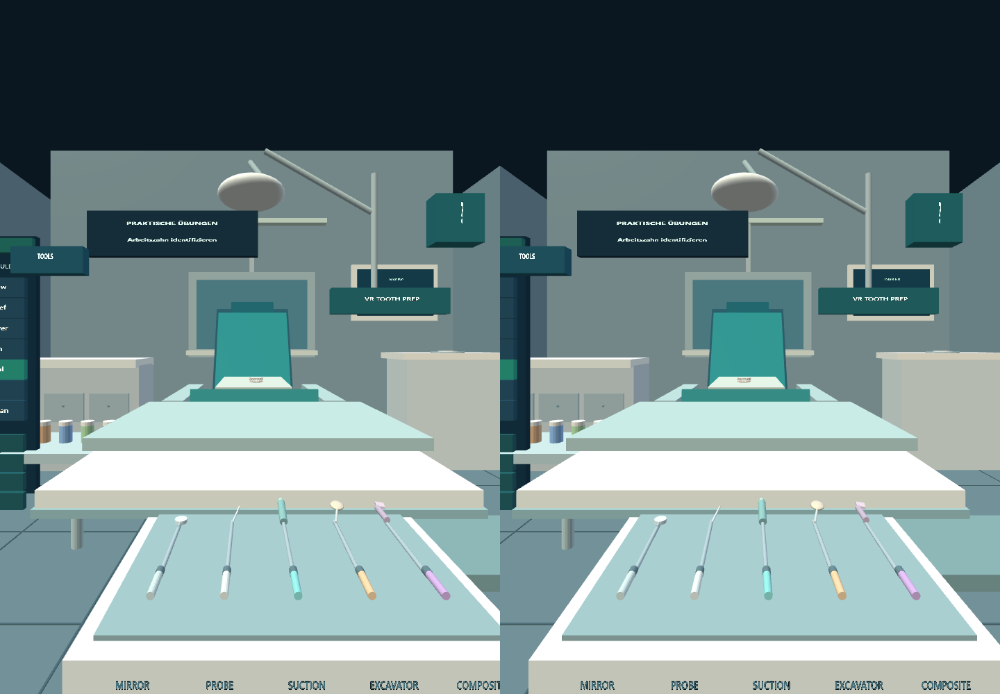
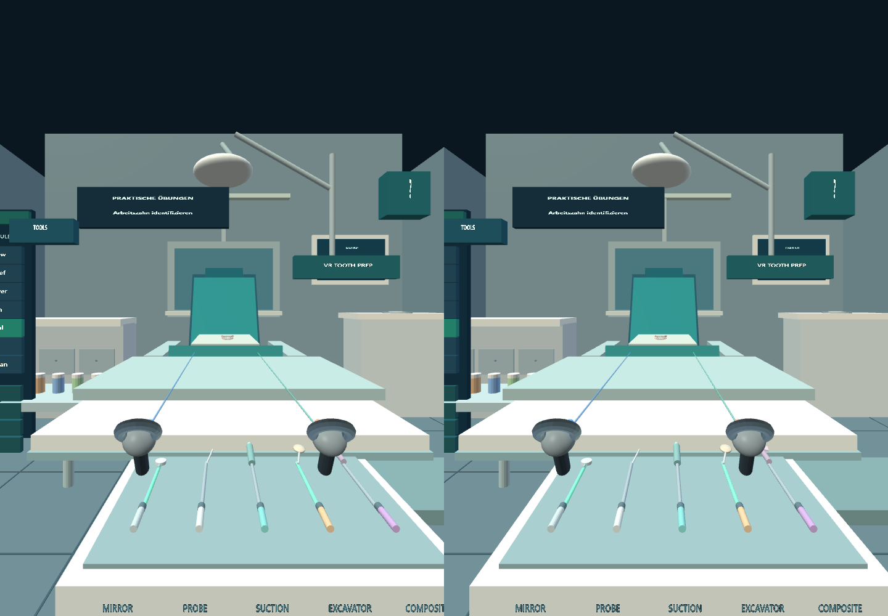
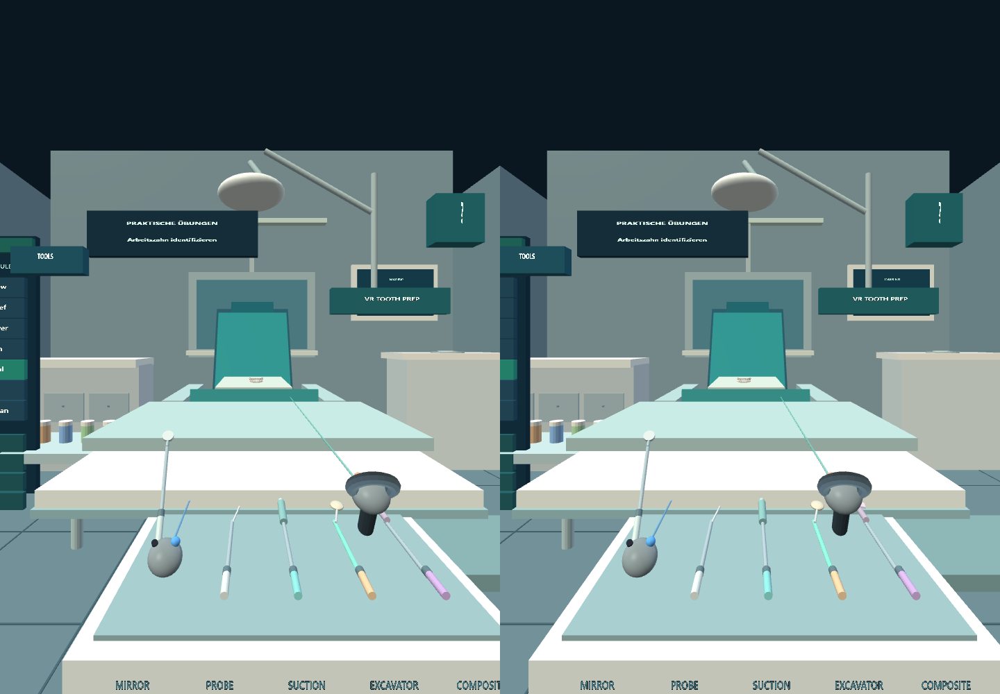
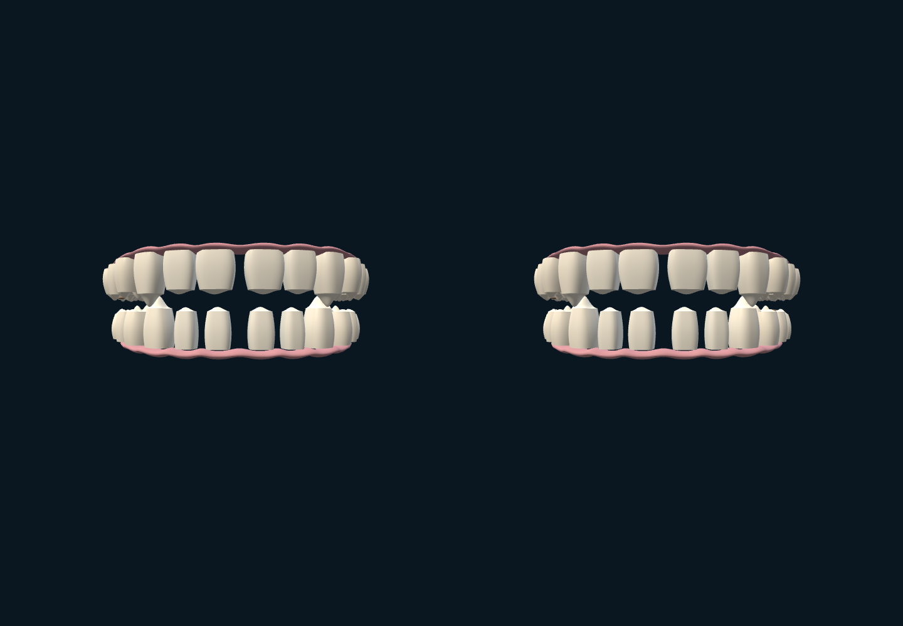
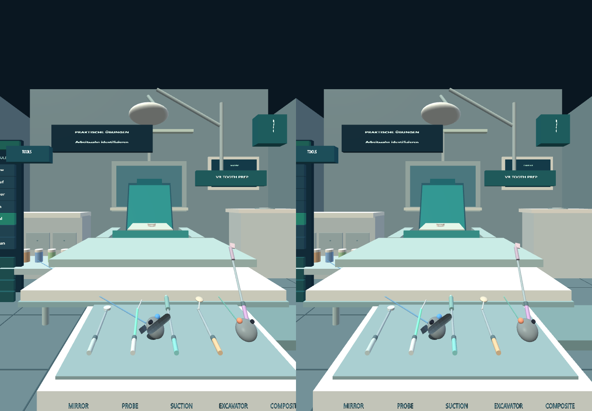
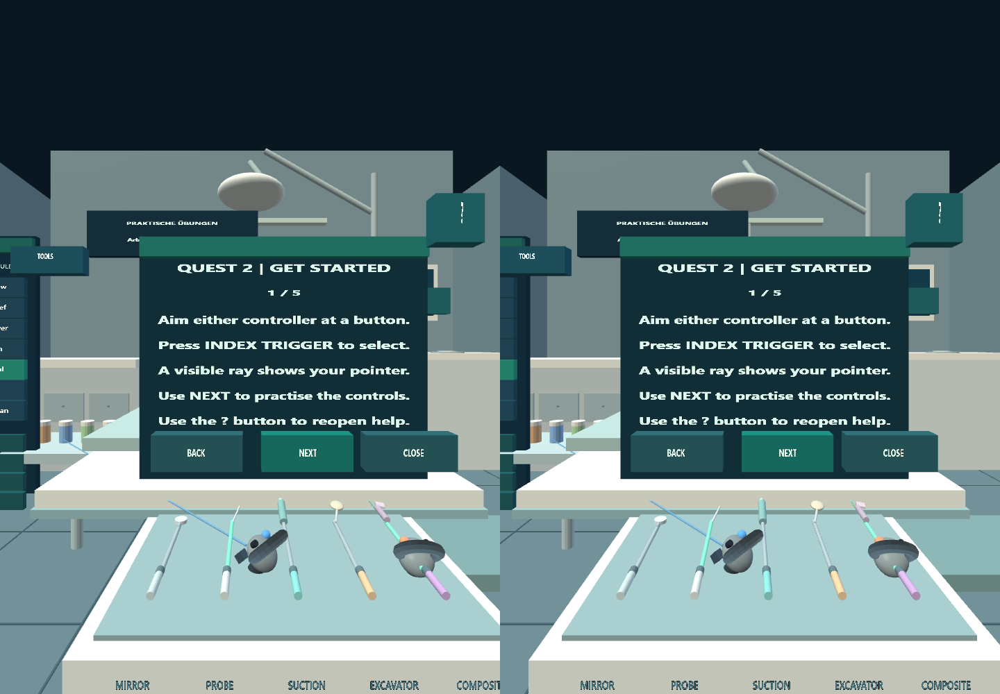
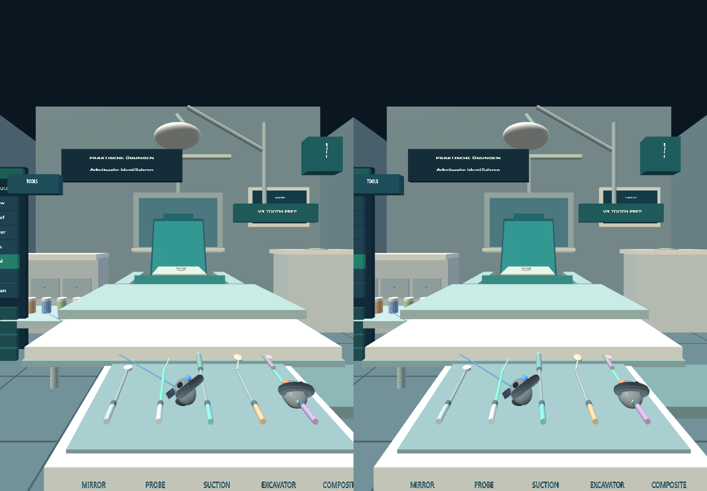
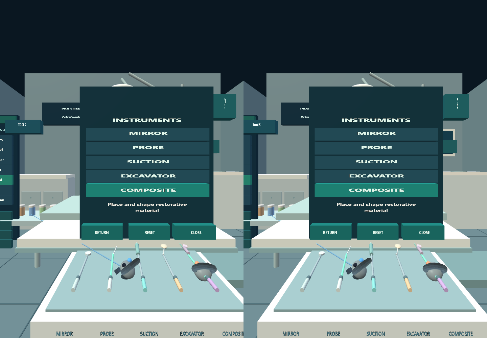

# Owner-PC XR evidence

Job: pc-xr-procedure-fdi16-20261031-10
Tested commit: 49f921f0a09983ac27d89d8df0c5dec67c9fb5f5

Meta IWER Quest2 in desktop Chrome; not physical headset evidence.
Captured from a newly rendered XR eye frame when framebuffer readback is supported.
Duplicate frames: [{"file":"10-tool-catalog-closed.png","sameAs":"08-help-closed-after-close.png"}]

## 01-room-table-unobstructed.png

## 02-both-controller-models.png

## 03-left-tool-hover.png

## 04-left-hand-mirror-pickup.png

## 05-mirror-release-return.png

## 06-right-hand-composite-pickup.png

## 07-help-opened-by-question-mark.png

## 08-help-closed-after-close.png

## 09-tool-catalog-open.png

## 10-tool-catalog-closed.png

## OPTIONAL ACTUAL-APP FDI16 PROCEDURE (not a filmed dentist or physical Quest2)

Automated IWER controller; non-calibrated educational preparation; professional dental review pending.

[Read six-step storyboard](./procedure/fdi16-pc-xr-procedure-fdi16-20261031-10/storyboard.md)

[Inspect original manifest](./procedure/fdi16-pc-xr-procedure-fdi16-20261031-10/procedure-manifest.json)

### Step 1 — Select FDI 16 in active tooth preparation

### Step 2 — Inspect untreated occlusal geometry, fixed stereo camera

### Step 3 — Aim tracked right-hand IWER target ray at crown

### Step 4 — After real in-app trigger-driven educational preparation cut

### Step 5 — Review cut and recorded FDI context

### Step 6 — Return to FDI 16 after switching to FDI 36

[Short real-XR six-step WebM (Playwright-controlled recording) — decoder/clinical review pending](./procedure/fdi16-pc-xr-procedure-fdi16-20261031-10/video/actual-app-stereo-steps.webm)

[Full Playwright browser viewport recording (includes test setup; playback review pending)](./procedure/fdi16-pc-xr-procedure-fdi16-20261031-10/video/actual-app-playwright.webm)
