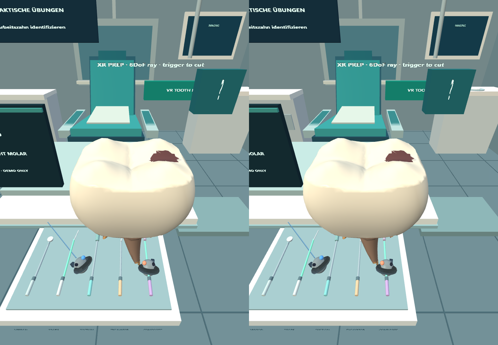
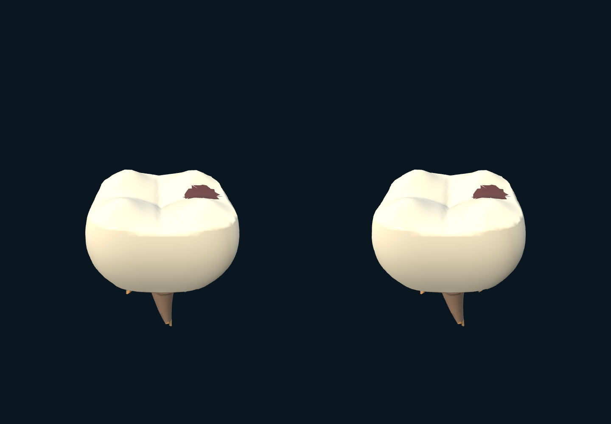
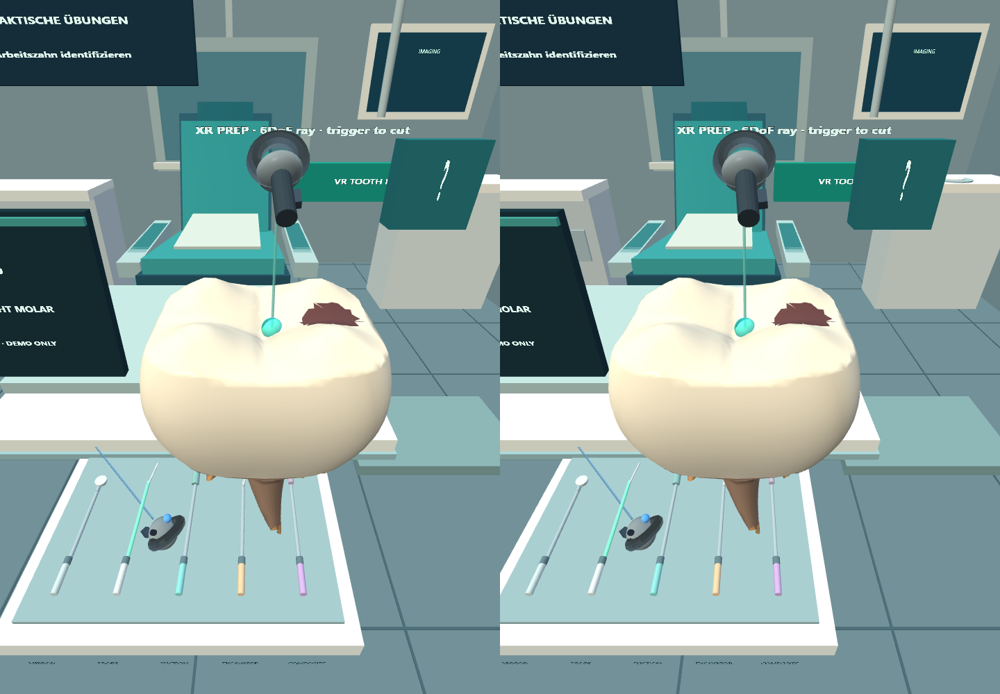
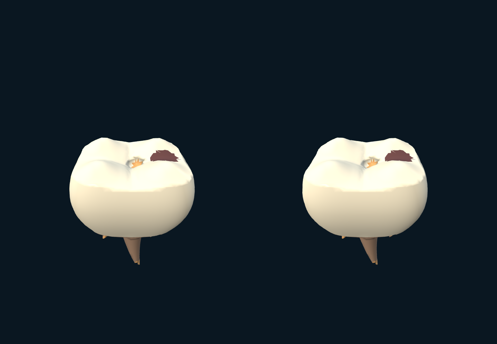

# Actual-app KlinikLab XR FDI16 educational procedure

Source commit: 49f921f0a09983ac27d89d8df0c5dec67c9fb5f5; run: fdi16-pc-xr-procedure-fdi16-20261031-10
Meta IWER Quest2, controlled by scripted Playwright trigger. Not a human dentist, actual patient, clinical validation or physical Quest headset.
Browser video will show sequential true XR framebuffer frames; it is NOT continuous hand-motion recording.

## Step 1: Select FDI 16 in active tooth preparation
FDI: 16; saved cuts: 0; XR frame 69; SHA-256 651aeb45e506d7bac5512d4a9f8b00bd6d028f3bc00882a81f3c8c0e35febc42

## Step 2: Inspect untreated occlusal geometry, fixed stereo camera
FDI: 16; saved cuts: 0; XR frame 141; SHA-256 ecb5b8dfffb9a0d7716788da2358b5f78e3aa846eb79916dedbb1097d9a942b2

## Step 3: Aim tracked right-hand IWER target ray at crown
FDI: 16; saved cuts: 0; XR frame 216; SHA-256 780fa5698b798001191d03a9df3668d5f7dde6f63429246f65579a2d9fbab547

## Step 4: After real in-app trigger-driven educational preparation cut
FDI: 16; saved cuts: 1; XR frame 295; SHA-256 ebbb438559c3f826d8dcddbc6e0147354c631276b8e2f02b96958e75ae2dacb8

## Step 5: Review cut and recorded FDI context
FDI: 16; saved cuts: 1; XR frame 371; SHA-256 dc034cd2186a22fd3ba6231a6d377b200f4ea8364cbb8635cf46a7343ce639cd

## Step 6: Return to FDI 16 after switching to FDI 36
FDI: 16; saved cuts: 1; XR frame 441; SHA-256 ebbb438559c3f826d8dcddbc6e0147354c631276b8e2f02b96958e75ae2dacb8

Actual stereo changed pixels at RGB L1 >55: [1233,1197]
Dental expert review, actual tool-use realism, and physical Quest2 remain pending.
