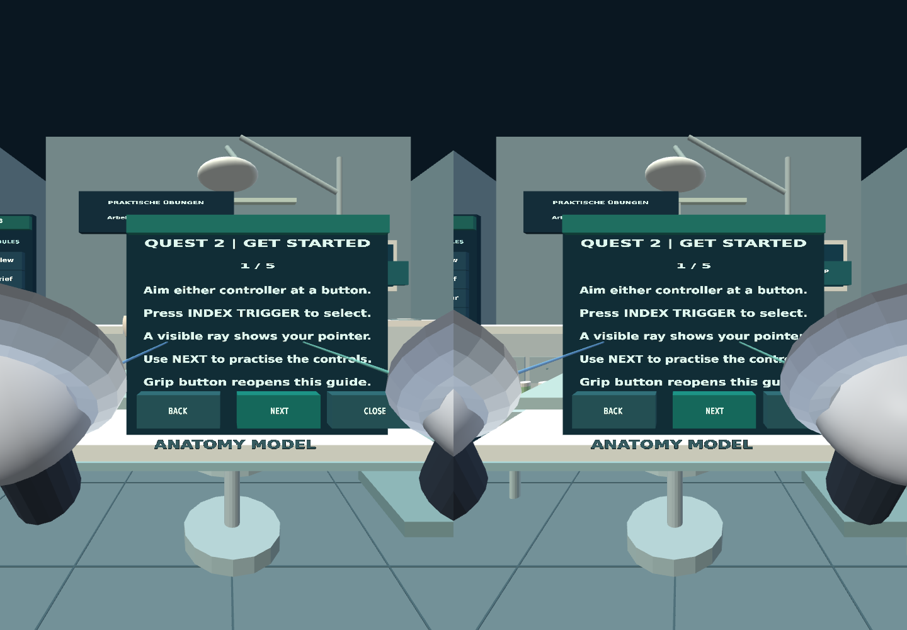
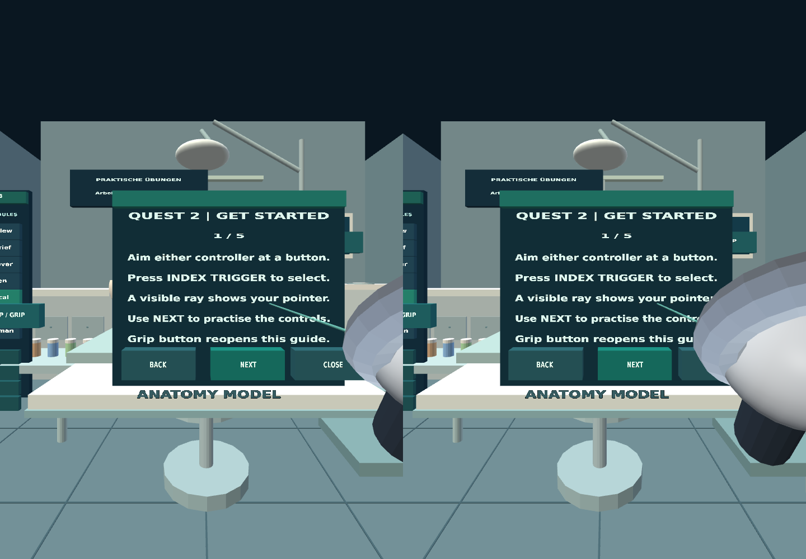
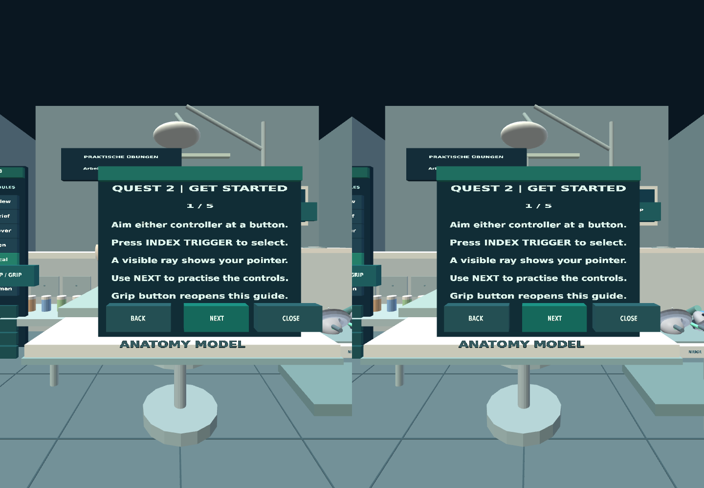
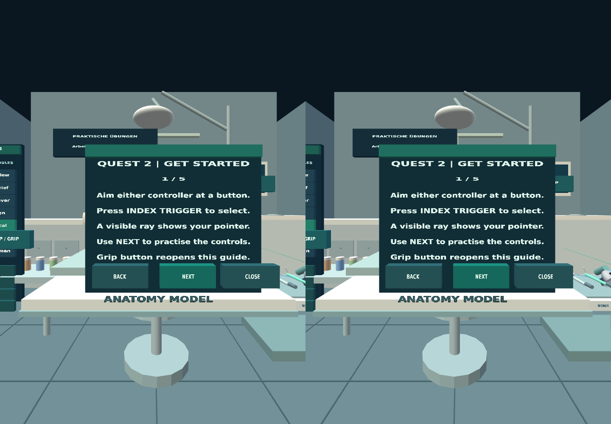

# Phase 3 IWER emulator screenshots

Tested integration commit: `891a0a4cf7e7d11fe2c783dc0d487e3d90599cb4`

**Environment:** Meta IWER Quest 2 profile in desktop Chrome under GitHub-hosted Xvfb. Not a physical Quest 2 photograph or verified headset view.
**Capture verification:** Six labeled PNG files were uploaded after a passing 14-check IWER interaction run. Git blob comparison shows that `01` and `02` are byte-identical and that `03` and `04` are byte-identical. Thus the screenshot pixels do **not** independently demonstrate controller-model visibility or the hover-to-held visual transition, despite passing underlying WebXR interaction-state assertions. These are desktop browser viewport captures during an immersive IWER session, not guaranteed per-eye headset framebuffer images. The allegedly unobstructed room image has not been visually verified as unobstructed; captions identify the intended capture checkpoint, not a certified visible composition. Physical Quest 2 acceptance remains pending.

- **XR room and instrument table, baseline**: [open image](./01-room-table-unobstructed.png)
- **XR scene with both controller models (presence inferred from renderer; visual quality not yet reviewed)**: [open image](./02-both-controller-models.png)
- **Left grip near mirror with hover feedback**: [open image](./03-left-tool-hover.png)
- **Mirror held by left controller**: [open image](./04-left-hand-mirror-pickup.png)
- **Mirror returned to instrument tray after grip release**: [open image](./05-mirror-release-return.png)
- **Composite tool held by right controller**: [open image](./06-right-hand-composite-pickup.png)

### XR room and instrument table, baseline

### XR scene with both controller models (presence inferred from renderer; visual quality not yet reviewed)

### Left grip near mirror with hover feedback

### Mirror held by left controller

### Mirror returned to instrument tray after grip release

### Composite tool held by right controller

