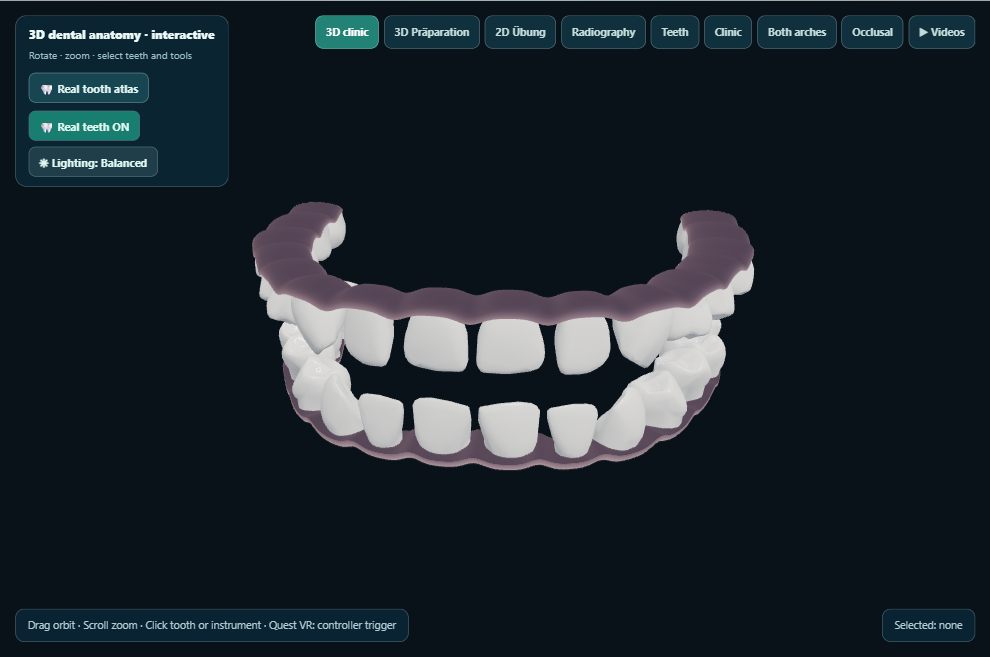
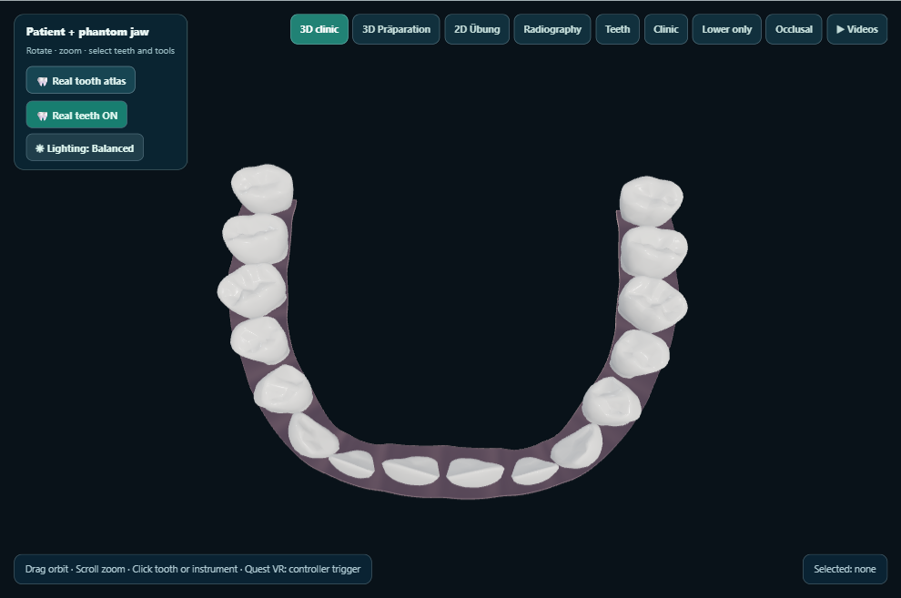
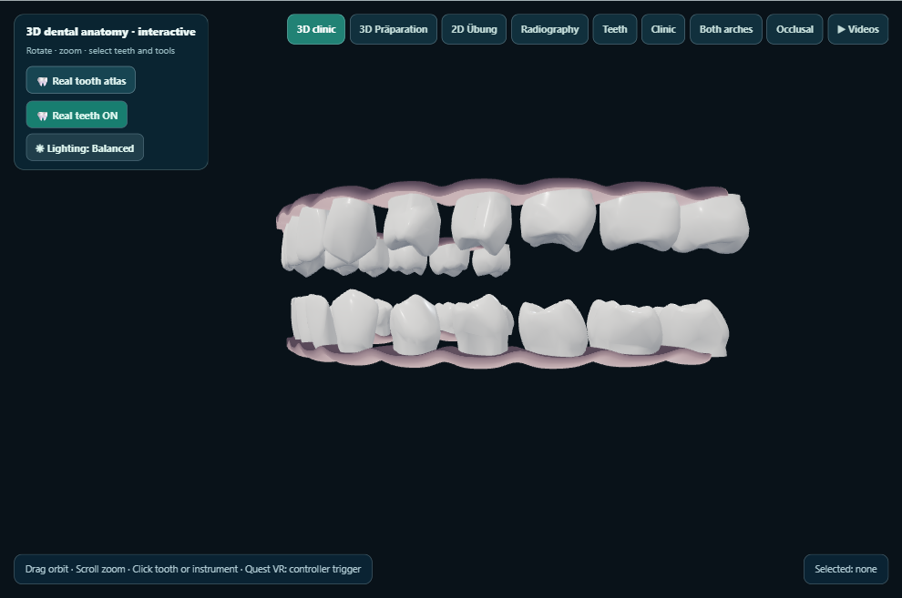

# KlinikLab visual QA — phase3-materials-2026-10-29-01

Desktop captures generated on the owner’s PC. This does not test Quest 2.

Captured 3/8 views.

## 01-balanced-frontal

## 02-balanced-occlusal

## 03-balanced-oblique

## 04-studio-frontal

Capture failed: Phase 3 appearance QA failed: {"b":{"mode":"babylon","ready":true,"meshes":176,"frames":638,"environment":"disabled","error":null,"anatomyVersion":5,"gingivalVertices":11572,"gingivalTriangles":23136,"archDiagnostics":{"teeth":32,"archCounts":[16,16],"pairs":[{"pair":"18-17","gap":0.0204},{"pair":"17-16","gap":0.0197},{"pair":"16-15","gap":0.0199},{"pair":"15-14","gap":0.0263},{"pair":"14-13","gap":0.0232},{"pair":"13-12","gap":0.0127},{"pair":"12-11","gap":0.0182},{"pair":"11-21","gap":0.0126},

## 05-studio-occlusal

Capture failed: Phase 3 appearance QA failed: {"b":{"mode":"babylon","ready":true,"meshes":176,"frames":652,"environment":"disabled","error":null,"anatomyVersion":5,"gingivalVertices":11572,"gingivalTriangles":23136,"archDiagnostics":{"teeth":32,"archCounts":[16,16],"pairs":[{"pair":"18-17","gap":0.0204},{"pair":"17-16","gap":0.0197},{"pair":"16-15","gap":0.0199},{"pair":"15-14","gap":0.0263},{"pair":"14-13","gap":0.0232},{"pair":"13-12","gap":0.0127},{"pair":"12-11","gap":0.0182},{"pair":"11-21","gap":0.0126},

## 06-studio-oblique

Capture failed: Phase 3 appearance QA failed: {"b":{"mode":"babylon","ready":true,"meshes":176,"frames":678,"environment":"disabled","error":null,"anatomyVersion":5,"gingivalVertices":11572,"gingivalTriangles":23136,"archDiagnostics":{"teeth":32,"archCounts":[16,16],"pairs":[{"pair":"18-17","gap":0.0204},{"pair":"17-16","gap":0.0197},{"pair":"16-15","gap":0.0199},{"pair":"15-14","gap":0.0263},{"pair":"14-13","gap":0.0232},{"pair":"13-12","gap":0.0127},{"pair":"12-11","gap":0.0182},{"pair":"11-21","gap":0.0126},

## 07-studio-upper

Capture failed: Phase 3 appearance QA failed: {"b":{"mode":"babylon","ready":true,"meshes":176,"frames":642,"environment":"disabled","error":null,"anatomyVersion":5,"gingivalVertices":11572,"gingivalTriangles":23136,"archDiagnostics":{"teeth":32,"archCounts":[16,16],"pairs":[{"pair":"18-17","gap":0.0204},{"pair":"17-16","gap":0.0197},{"pair":"16-15","gap":0.0199},{"pair":"15-14","gap":0.0263},{"pair":"14-13","gap":0.0232},{"pair":"13-12","gap":0.0127},{"pair":"12-11","gap":0.0182},{"pair":"11-21","gap":0.0126},

## 08-studio-lower

Capture failed: Phase 3 appearance QA failed: {"b":{"mode":"babylon","ready":true,"meshes":176,"frames":642,"environment":"disabled","error":null,"anatomyVersion":5,"gingivalVertices":11572,"gingivalTriangles":23136,"archDiagnostics":{"teeth":32,"archCounts":[16,16],"pairs":[{"pair":"18-17","gap":0.0204},{"pair":"17-16","gap":0.0197},{"pair":"16-15","gap":0.0199},{"pair":"15-14","gap":0.0263},{"pair":"14-13","gap":0.0232},{"pair":"13-12","gap":0.0127},{"pair":"12-11","gap":0.0182},{"pair":"11-21","gap":0.0126},
