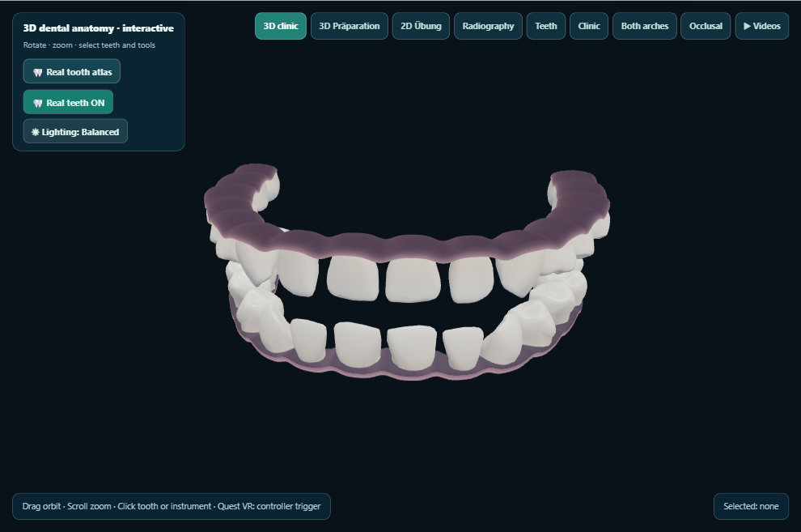
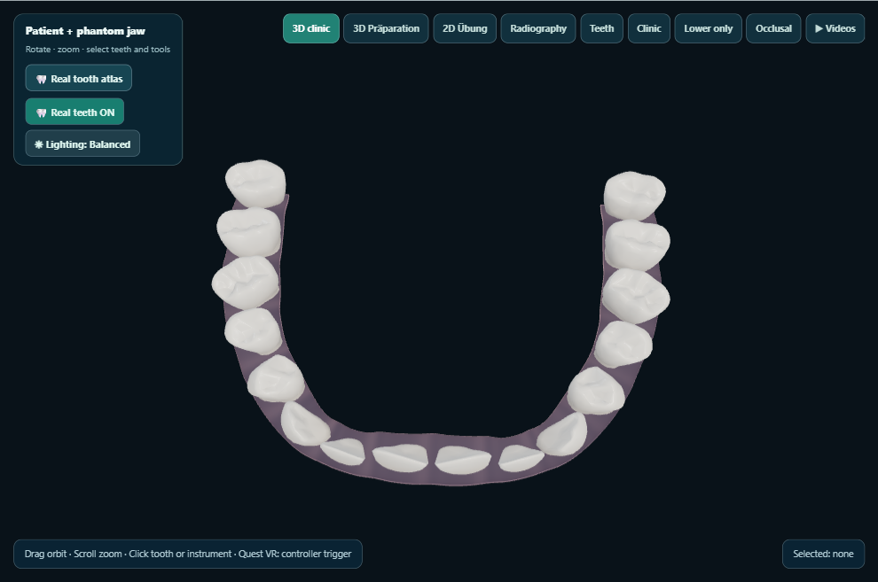
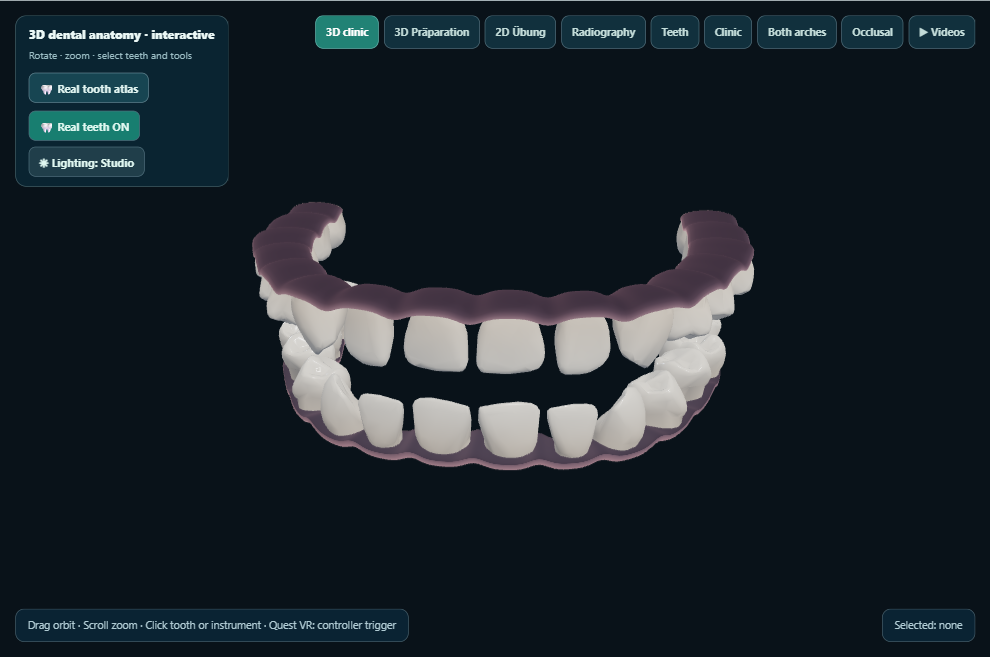
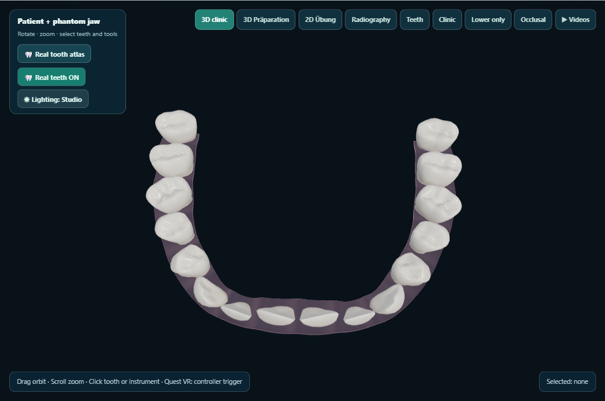
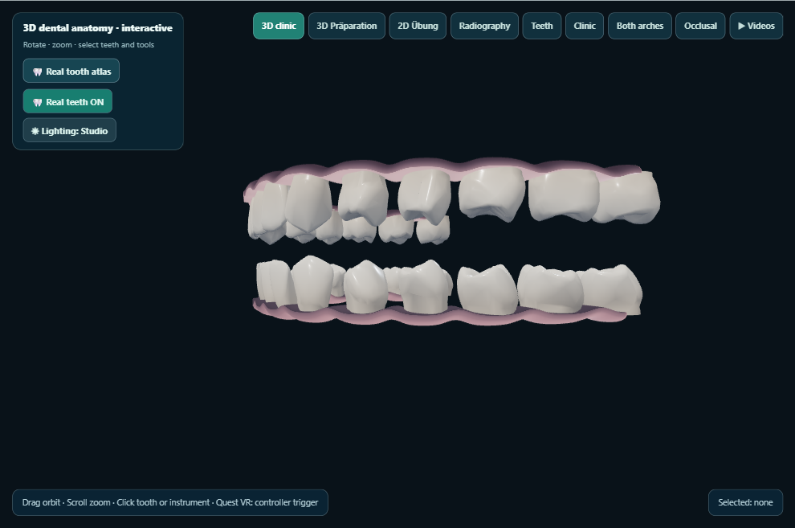
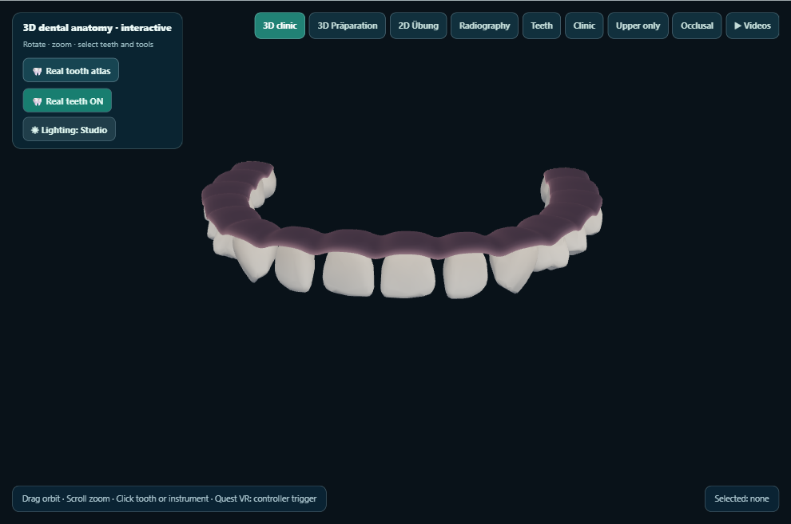
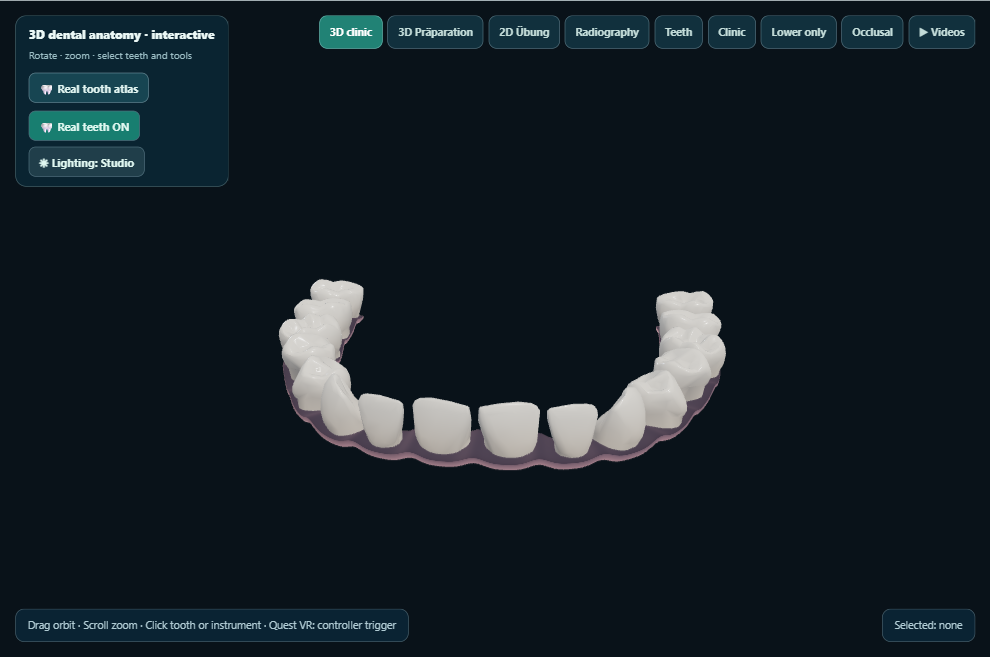

# KlinikLab visual QA — phase3-materials-final-2026-10-29-03

Desktop captures generated on the owner’s PC. This does not test Quest 2.

Captured 8/8 views.

## 01-balanced-frontal

## 02-balanced-occlusal

## 03-balanced-oblique

## 04-studio-frontal

## 05-studio-occlusal

## 06-studio-oblique

## 07-studio-upper

## 08-studio-lower

