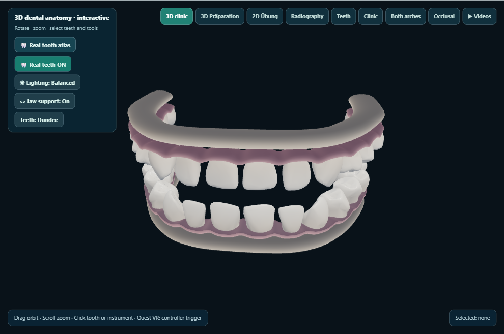
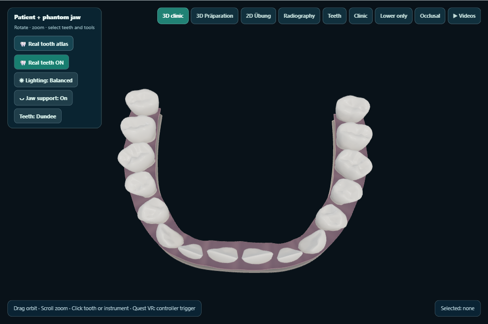
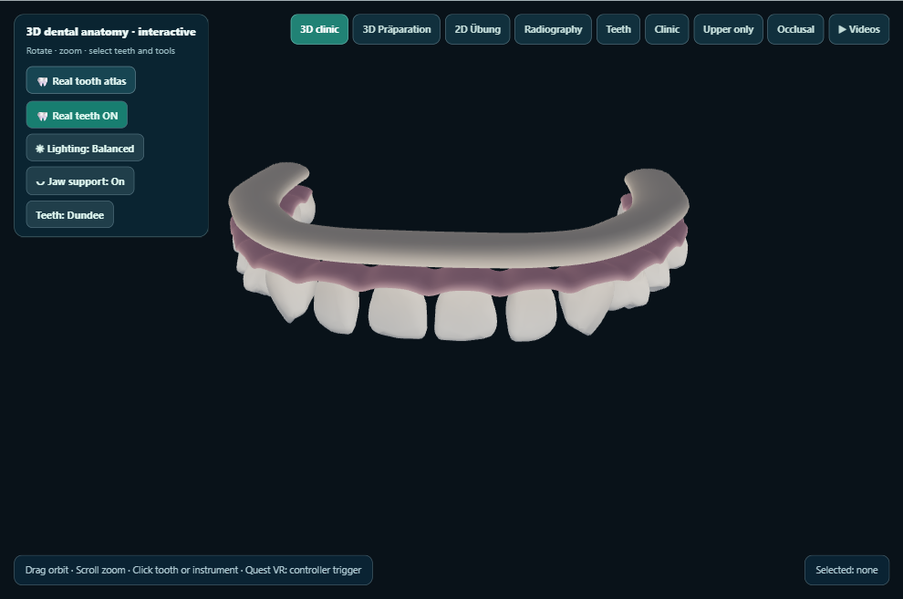
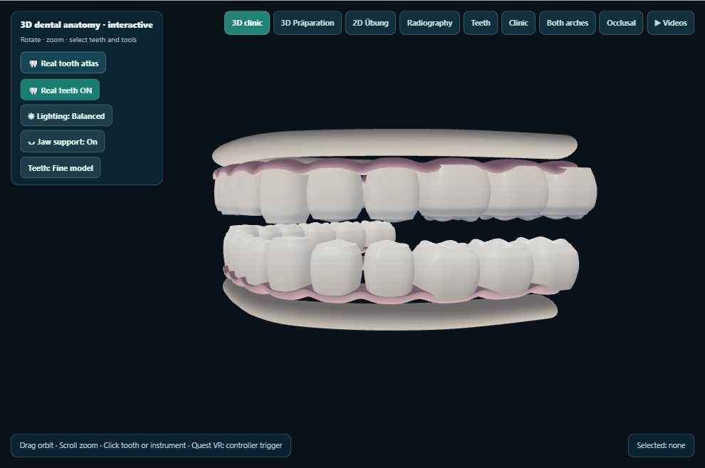
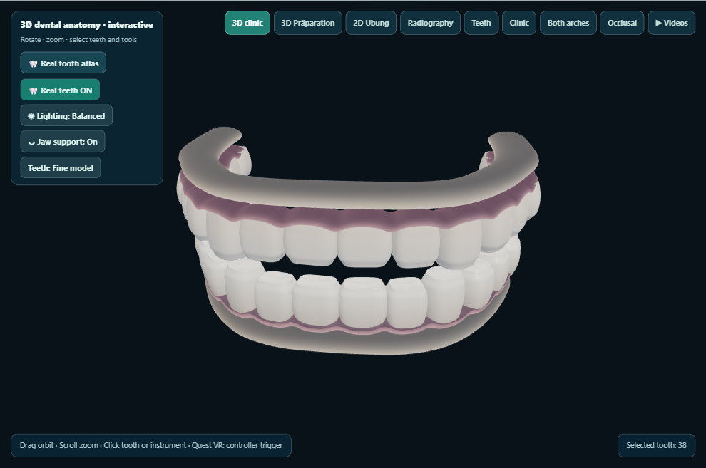

# KlinikLab visual QA — phase4-jaw-refined-2026-10-29-03

Desktop captures generated on the owner’s PC. This does not test Quest 2.

Captured 5/5 views.

## 02-dundee-jaw

## 03-dundee-jaw-occlusal

## 04-dundee-upper-jaw

## 06-fine-jaw-oblique

## 08-fine-jaw-fdi

