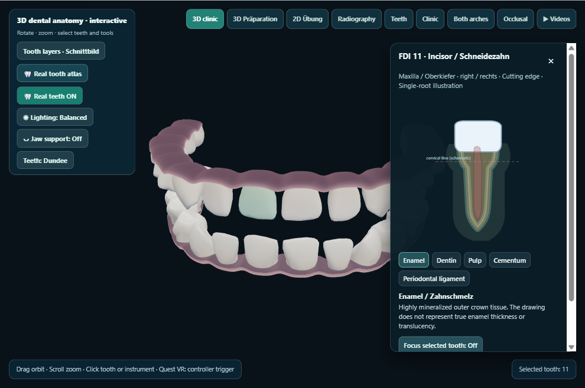
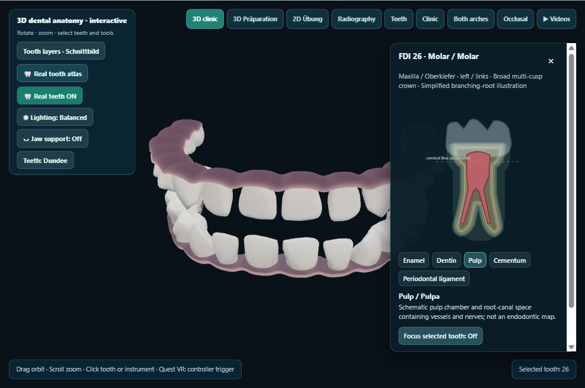
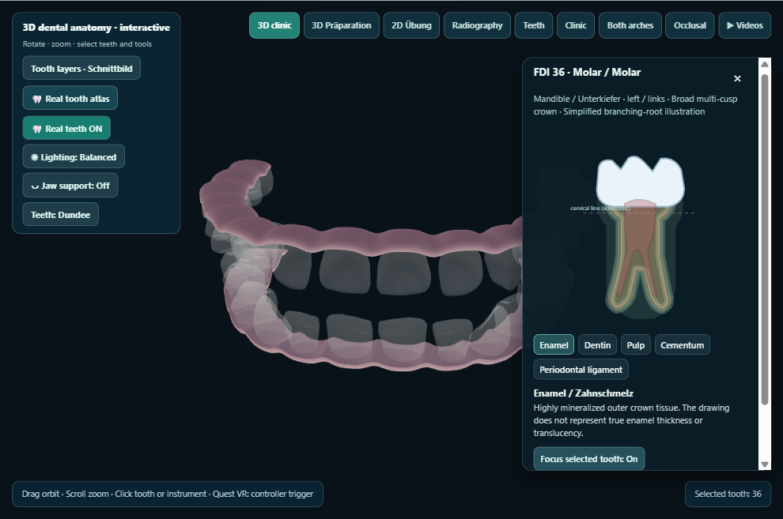
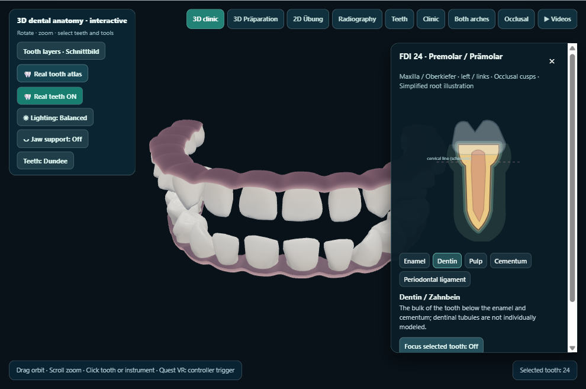

# KlinikLab visual QA — phase5-structures-2026-10-29-01

Desktop captures generated on the owner’s PC. This does not test Quest 2.

Captured 5/5 views.

## 01-incisor-enamel

## 02-molar-pulp

## 03-molar-focus

## 04-premolar-dentin

## 05-fdi-32

